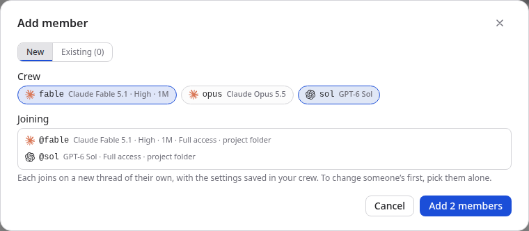
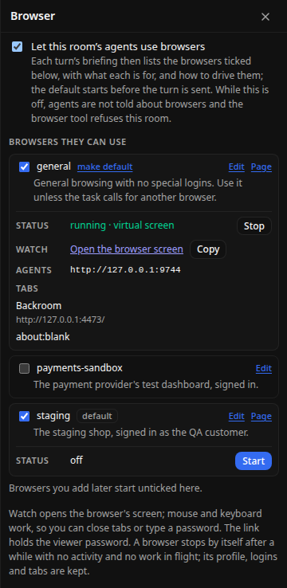
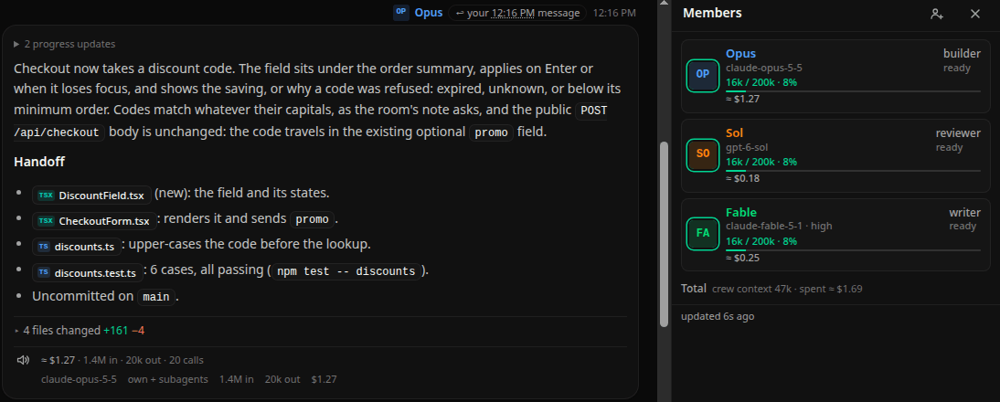
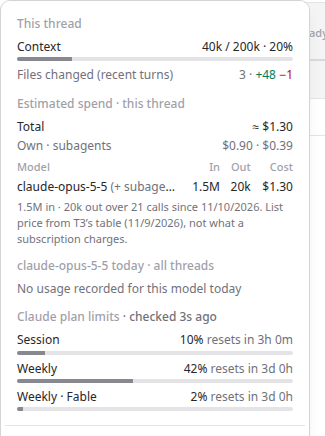

# Backroom


Backroom is the back room where the boss hands out the work. It is a local companion for [T3 Code](https://github.com/pingdotgg/t3code): a **room** is one shared conversation, and the **members** seated in it are T3 threads, each under a short alias (`@claude`, `@grok`, …). You address them in plain text, or talk to one of them, the **Consigliere**, who hands out the work and reports back. Every message becomes a numbered request on the room's board, each member's final reply is its answer, and the answer reaches whoever asked. You don't have to copy anything between threads yourself.

Your **crew** are the people you bring into rooms: a name with a model and its options, a permission mode and a place to work. Drag one onto a room and they are seated on a new thread.

Backroom owns conversation and coordination. T3 owns execution: every member is a real T3 thread, with its own model, permissions and worktree, and you can still open it in T3 Code. No model reads your input on Backroom's side: every action is a direct control or a small explicit syntax, and the composer shows the plan before you send. [How it works](#how-it-works) at the end describes the delivery, correlation and completion rules.

**Why Backroom.** T3 Code is a cockpit for each agent: a thread, a conversation, its terminal, diffs and worktree, and it can start several agents at once and tell you when each finishes. Its agents can hand work to each other (an agent can delegate a task to a child agent on another model, and read or message other threads), but who does what is the agent's own decision as it goes, and each thread stays its own conversation. A room is one conversation for several agents that you direct: you address them by name, or let your Consigliere hand out the work and sequence it, and each answer goes to whoever asked, with where the work is. T3 still runs every turn, and every member stays a thread you can open in T3 Code.

---

## Contents

1. [What Backroom adds to T3 Code](#what-backroom-adds-to-t3-code)
2. [Requirements](#requirements)
3. [Install](#install)
4. [Connect to T3 Code](#connect-to-t3-code)
5. [A headless box over Tailscale](#a-headless-box-over-tailscale)
6. [Try it without T3 (demo mode)](#try-it-without-t3-demo-mode)
7. [Your first room](#your-first-room)
8. [Projects, and threads without a room](#projects-and-threads-without-a-room)
9. [The agents file](#the-agents-file)
10. [Writing messages](#writing-messages)
11. [Sending while someone is working](#sending-while-someone-is-working)
12. [T3 slash commands](#t3-slash-commands)
13. [The Consigliere](#the-consigliere)
14. [Room browser](#room-browser)
15. [What the room shows](#what-the-room-shows)
16. [Managing rooms and members](#managing-rooms-and-members)
17. [The overview](#the-overview)
18. [Keyboard](#keyboard)
19. [The pixel look](#the-pixel-look)
20. [Configuration](#configuration)
21. [Running, updating and backing up](#running-updating-and-backing-up)
22. [Troubleshooting](#troubleshooting)
23. [Development](#development)
24. [How it works](#how-it-works)

---

## What Backroom adds to T3 Code

Each part below starts from what T3 Code does (read from [its source and docs](https://github.com/pingdotgg/t3code)), then shows what Backroom adds. The screenshots come from a demo room: the fake T3 with scripted replies and the usage records a harness would leave.

### Agents that work together

In T3 Code each thread is its own conversation. An agent can involve others: it can delegate a task to a child agent on any provider and wait for the result, and T3's tools let it read, message and start other threads. What gets delegated, to whom and in what order is decided by that agent while it works, and you see it in its thread afterwards.

In a room, several threads share one conversation, and you decide who does what, or tell your Consigliere what you want and let him decide. Each request is a numbered post on the room's board, and each member's final reply answers it, ending with a Handoff that says where the work is (folder, branch, commit). Nothing waits on other work by itself: the Consigliere sends the next step when the one it builds on has answered.

### The plan before anything runs

T3 Code sends what you type to one agent. Backroom reads a message with fixed rules, not a model, and shows what will happen before you send it: who gets which instruction, and whether it starts now or next, after the member's current turn. A mention that may only be a reference gets a one-click fix, and a message that would wait on other work says so before it is sent.

### A crew instead of settings each time

T3 Code remembers the last model, has favorites, custom models and a project default. A Backroom crew member bundles a model and its options, a permission mode and where they work. Drag one onto a room, or pick several in the Add member dialog and seat them at once.



### What finished, room by room

T3 Code notifies you, per thread, when an agent finishes, fails or needs you, and marks unread threads. In Backroom one room holds several threads, so the overview says it per room: a count of new replies on the room's tile, and the tile moves forward among the rest. Threads on their own get a **new** (or **failed**) mark the same way. What you have seen is kept by the service, so looking on your phone clears it on your Mac, and **Notifications** in the settings menu in the overview's header adds system notifications. See [What finished while you were away](#what-finished-while-you-were-away).

### Browsers on the box, chosen per room

T3 Code's agent browser runs inside its desktop app: it works while that app is open and connected, and a headless server has no browser of its own. Backroom runs named Chrome browsers on the machine itself. They keep their logins, every harness drives them with one command, you can watch and take over through a link, and each room (or thread) decides which ones its agents may use and which starts by default. See [Room browser](#room-browser).



### What each thread and each reply cost

T3 Code's Usage page reports tokens and estimated cost by day, provider and model, across every thread: it can't say what one thread cost, or one answer. Backroom works that out from what is already on the machine (T3's record of each thread's harness sessions, the harnesses' own transcripts, T3's price table), priced the way T3 prices its totals, so the two agree.

- **Every reply** carries what the turn behind it used: the cost, tokens in and out, the number of calls, and a row per model, subagents included. When several turns answered one message, it also shows the running total since that message.
- **Every member** shows what its thread has used, and the room shows the total for everyone it ever seated. A thread on its own shows the same in its bar.
- **A member's card** splits the thread's spend into its own calls and its subagents', per model.

So you can see what a task cost before you ask for the next one, and which model is worth it for which job: here the review on GPT-6 Sol cost about $0.18, against $1.27 for Opus's build. The figures are list prices, a measure of consumption, not what a subscription charges. See [Estimated spend](#estimated-spend).





### What stays in T3 Code

Running every turn, terminals, the preview browser with its annotations and recordings, simulators, pull requests and rewinding a conversation are T3 Code's. Backroom never takes a thread away from it: any member or thread opens in T3 Code as it is.

---

## Requirements

- **Node 24 or newer.** The service runs TypeScript directly through Node's type stripping and stores data with the built-in `node:sqlite`, so it has no build step. Only the web UI is built. Check with `node --version`.
- **npm** (bundled with Node).
- **T3 Code**, with a server Backroom can reach over HTTP. Either of these works:
  - the **T3 Code Desktop app**, with **Settings → Connections → Network access** turned on (see below);
  - a headless server started with `t3 serve`, or installed with `t3 service install`.
- The harnesses you want in rooms (Claude, Codex, Cursor, Grok, OpenCode, …) are set up and signed in **inside T3**. Backroom never talks to a harness directly.

Backroom speaks T3 Code's **Orchestrator V2** (orchestration protocol 2): it needs a T3 server on **0.0.46 or newer**. Against an older server it says so in the T3 status in the overview's header and still offers T3's update there (see [Moving a server from T3's V1 to V2](#moving-a-server-from-t3s-v1-to-v2)). Tested against T3 Code 0.0.46-nightly.20261003 on a headless Ubuntu box (see [A headless box over Tailscale](#a-headless-box-over-tailscale)).

## Install

```sh
git clone https://github.com/moonmoon69/backroom.git
cd backroom
npm install          # installs the service and the web workspace
npm run build:web    # builds the UI into web/dist (the service serves it)
npm start            # http://127.0.0.1:4400
```

Open <http://127.0.0.1:4400>. The service binds to `127.0.0.1` only, so it is not reachable from other machines.

At startup the service logs the T3 address it will use and whether it has credentials:

```
[backroom] … T3 base URL http://127.0.0.1:3773; credentials missing (pair from the UI)
[backroom] … listening on http://127.0.0.1:4400 (db /…/backroom/data/rooms.sqlite)
```

The T3 address is found automatically from `~/.t3/userdata/server-runtime.json`, which T3 writes while it runs. Set `T3_BASE_URL` if your server is elsewhere.

## Connect to T3 Code

Backroom is a third-party client of your T3 server, so it needs a credential: a bearer token with the permissions listed below. It is stored in `data/t3-auth.json` with owner-only permissions (0600) and is never sent to the browser.

### 1. On T3's machine: nothing to do

When Backroom runs on the machine where T3 runs as a service, it gets its own credential from T3's command line. It runs `t3 auth session issue` with exactly the permissions below, for 30 days, labeled "Backroom". Backroom uses the version of T3 that T3's service runs (`~/.t3/runtime/versions/<version>/t3`), or the binary named by `T3_CLI`. The service log says which way it keeps its credential: `credentials present, renewed by Backroom with T3's CLI`.

### 2. Anywhere else: pair with a link

When Backroom runs elsewhere, or T3 runs without its service (the desktop app, a dev checkout), T3 hands out credentials through **one-time pairing links**:

- **Headless server** (`t3 serve` or the installed service): run `t3 pair` on T3's machine. Its links hold every permission Backroom asks for.
- **Desktop app:** open **Settings → Connections** and turn on **Network access** (the app restarts). Then create a pairing link on the same screen. On loopback only, the Desktop server runs under the `desktop-managed-local` auth policy and offers no pairing links. That is why Network access is required.

Treat pairing links like passwords. They expire within minutes and work only once. Paste the link into the pairing panel: Backroom shows it in place of the rooms while it has no credential, and the **T3** status button in the overview's header opens it later. Or use the command line, then restart the service:

```sh
npm run t3:pair -- "http://127.0.0.1:3773/pair?token=..."
```

The command prints only the scope and expiry, and names any permission the link did not hold.

### What Backroom asks for, and why

| Permission | What needs it |
| --- | --- |
| `orchestration:read`, `orchestration:operate` | reading projects and threads, sending messages, launching threads, adding projects |
| `providers:manage` | a harness's **Update** |
| `environment:maintain` | T3's **Update** |
| `diagnostics:read` | today's usage in a member's usage card |
| `filesystem:read` | the folder list in the New project dialog |

It asks for nothing broader: not T3's settings, terminals, previews, source control, file writes, or the management of other clients. T3 0.0.46-nightly.20261007 started checking the four below `orchestration:operate`. Before that, `orchestration:operate` covered the updates and `orchestration:read` covered the other two. So a credential from an older pairing lacks them.

### How the credential is kept

- **On T3's machine, Backroom renews it.** It checks at start and every hour. It gets a new credential when it has none, when it lacks a permission it asks for, when it has less than 7 days left, or when T3 no longer takes it (HTTP 401: a revoked, expired or reset session). A refusal for a missing permission (HTTP 403) is not a reason: a new credential with the same permissions would be refused too. Backroom checks that T3 takes the new credential, switches to it and revokes the session it replaced, so T3's client list keeps one "Backroom". Revoking Backroom in T3's client list does not lock it out from that machine: it issues itself a new session. To stop it, stop the service, or set `T3_CLI=off`.
- **A renewal that fails** is tried again by itself 5 minutes later, and every 5 minutes after that until one succeeds. From the first failure, the **T3** status button says "renewal failed", and the T3 panel says why and how to pair by hand. Within 7 days of expiry the panel leads with the date.
- **Elsewhere, renewing is yours.** T3 gives a paired client 30 days and offers it no way to renew. Its token exchange takes no longer lifetime and has no refresh token, and minting a new link over HTTP needs `access:write`, the permission to manage every client. From 7 days before expiry, the **T3** status button says "pair again soon", and the T3 panel says when the credential expires and how to pair again.
- A token given in `T3_ACCESS_TOKEN` is used as it is and never renewed.

### When T3 refuses for a missing permission

Backroom says so where it happened: on the row in **Updates**, in the folder list, or in the usage card. The message names the permission: "Backroom's pairing with T3 does not allow this (it lacks the "environment:maintain" permission): run `t3 pair` on T3's machine and paste the link it prints into the T3 panel …". On T3's machine Backroom fixes this itself at its next check, within the hour or at a restart. Elsewhere, pair again with a link from `t3 pair`. If pairing again does not help, T3 wants a permission Backroom does not ask for yet, and Backroom itself needs updating.

### Verify (optional but recommended)

```sh
npm run t3:check                                   # read-only: server descriptor, auth policy, projects, models, threads
npm run t3:check -- --write --project <projectId>  # launches one thread, follows its run, then checks a resend, queue, steer and interrupt
```

The `--write` check leaves one thread titled "Backroom contract check" in T3; delete it there when you are done. Copy a project id from a room's **⋯** menu, its **Open in T3** dialog, or from T3 itself.

## A headless box over Tailscale

The setup this was built on, and the one Theo describes for his own "bb-1": a headless Linux box runs the T3 Code server and Backroom as background services, and you work from a Mac or a phone anywhere on your tailnet. Nothing listens on the public internet.

**1. T3 Code on the box.** Install the server as a user service and pair it over Tailscale:

```bash
npx t3 service install          # runs `t3 serve` at boot, as your user
npx t3 pair --tailscale         # publishes it on Tailscale Serve (HTTPS) and prints a pairing link + QR code
```

Open that pairing link in the T3 Code desktop app on your Mac (or scan the QR code on the phone). The link is a password: it only ever travels inside the tailnet.

**2. Backroom on the box.** Run it as a user service too, and let user services run without a login session:

```bash
loginctl enable-linger "$USER"
mkdir -p ~/.config/systemd/user
"$EDITOR" ~/.config/systemd/user/backroom.service   # contents below
systemctl --user enable --now backroom.service
```

```ini
[Unit]
Description=Backroom
After=t3code.service
Wants=t3code.service

[Service]
Type=simple
WorkingDirectory=%h/Projects/backroom
Environment=PATH=%h/.local/bin:/usr/local/bin:/usr/bin:/bin
Environment=ROOMS_PORT=4400
Environment=ROOMS_BROWSER_MODE=vnc
Environment=ROOMS_BROWSER_BIND=100.x.y.z
Environment=ROOMS_BROWSER_HOST=box.tailnet-name.ts.net
ExecStart=/usr/bin/npm start
Restart=always
RestartSec=5
KillMode=mixed

[Install]
WantedBy=default.target
```

`ROOMS_BROWSER_BIND` is the box's Tailscale IP (`tailscale ip -4`) and `ROOMS_BROWSER_HOST` its MagicDNS name (`tailscale status`). Adjust `WorkingDirectory` and the `npm` path to where you cloned it and how you installed Node. `t3code.service` is the unit `t3 service install` creates.

**3. Reach Backroom from the tailnet.** It listens on `127.0.0.1` only. Publish it over HTTPS with Tailscale Serve on a port of its own (T3 Code's pairing already took 443):

```bash
tailscale serve --bg --https=8443 http://127.0.0.1:4400
tailscale serve status    # https://box.tailnet-name.ts.net:8443 -> http://127.0.0.1:4400 (tailnet only)
```

Open `https://box.tailnet-name.ts.net:8443` on the Mac or the phone. HTTPS matters on the phone: it is what lets Backroom install as an app and keep its shell offline (see [On a phone](#on-a-phone)).

**What is exposed where:** T3 Code and Backroom stay on loopback, reached only through Tailscale Serve. The browsers' noVNC viewers listen on the Tailscale IP because their watch links are meant to be opened from another device; their DevTools ports stay on loopback. Update Backroom with `git pull && npm install && npm run build:web && systemctl --user restart backroom.service`.

## Try it without T3 (demo mode)

```sh
ROOMS_ADAPTER=fake npm start
```

A simulated T3 takes the place of the real one. Its agents reply after about four seconds, and it offers sample slash commands (`/compact`, `/review`). Pairing is disabled in this mode. Use a separate data directory so demo rooms stay out of your real database:

```sh
ROOMS_ADAPTER=fake ROOMS_PORT=4401 ROOMS_DATA_DIR=/tmp/rooms-demo npm start
```

The demo project's folder is `/tmp/demo`, which need not exist. `ROOMS_FAKE_PROJECT_DIR=<folder>` points it at a folder of yours, a scratch git repository say, to see [the agents file](#the-agents-file) written, kept out of git and copied into a new worktree. In demo mode Backroom writes agents files only inside its data folder and `ROOMS_FAKE_PROJECT_DIR`: a real folder added to a demo instance as a project is never written in.

## Your first room

1. **Create a room.** Click **+** beside a project's name on the overview and give the room a title (the dialog has the project picked; you can change it). Every member's thread belongs to that project. When a Consigliere is chosen in Settings he is seated in the new room at once, as its Consigliere (see [The Consigliere](#the-consigliere)). When the project has no instructions for agents yet, Backroom writes the default ones into its folder, kept out of git and copied into new worktrees (see [The agents file](#the-agents-file)).
2. **Bring in a member.** Click the members button (two-person icon) in the room header, then the add button at the top of the Members panel (a person with a plus), and choose one of:
   - **New:** the member gets a new thread. Pick an alias, then the thread's T3 settings in one row, as in T3 Code's composer: the model (T3's default for the project is prefilled), its options (reasoning effort, context window and so on, in one dropdown) and the permission mode (Supervised, Auto-accept edits, Auto, Full access). Backroom creates the thread in T3.

     The model button opens a picker laid out like T3 Code's. A rail on the left lists your favorites and one icon per provider; the list beside it shows that provider's models, with its sign-in and usage above them and older models behind a **Legacy models** row. Typing searches every provider at once. The star on a row keeps the model under favorites (stored in this browser; T3's own favorites live in its app and are not shared). Keys: **↑/↓** move, **Enter** chooses, **←/→** change provider while the search field is empty, **Alt+1…9** (⌥ on a Mac) choose by position, **Esc** closes.

     **Where it works** (as in T3 Code's new-thread toolbar): the **Project folder** (the project's own checkout, on whatever branch it has, shared with anyone else working there), a **New worktree** (a folder and branch of its own, made in T3's worktrees folder from the base branch you pick), or one of the project's **existing worktrees**. A new worktree's branch is named after the room and the member (`payments/builder`) unless you type a name, because a member does many tasks and no single one names it well. T3 makes the worktree when you add the member (it fetches, checks out and runs the project's setup script, as for its own threads), so the folder exists before any task and every briefing can name it. The choice starts on T3's default for the project, and the worktree stays when the member is removed (the Git tab lists it).
   - **Existing:** pick one of the project's threads. The member continues that thread and keeps its model, options and permission mode.

   The alias is what you type after `@`, and it exists only inside this room.

   Quicker, once you have a crew: drag someone from **Crew** on the overview onto the room's tile, or pick them at the top of this dialog, several at once if you like (see [Crew](#crew)).
3. **Send work.** Type `@claude fix the failing parser test` and press **Enter**. The plan under the composer shows the result before you send: who receives what, and whether it starts now or next (after the member's current turn).
4. **Watch it run.** Your message appears on the left and the member's reply on the right. Progress notes stream in while the turn runs. When it ends, the final answer becomes the reply.

The composer placeholder cycles through examples built from your room's actual members, so every example can be sent as is.

## Projects, and threads without a room

The overview lists T3's projects as sections. In each are its rooms, then its T3 threads that no room holds, as tiles of their own. A thread an agent made as a subagent of its own is left out, as in T3's own list. Under the tiles, **Settled · N** and **Archived · N** fold open to T3's settled and archived threads for the project.

A thread is in one of three states in T3:

- **Active:** in the main list.
- **Settled:** T3's "done for now" list. It opens and reads as usual; sending it a message makes it active again. **Unsettle** in its ⋯ menu does the same without a message.
- **Archived:** hidden in T3 and reversible. T3 does not serve an archived thread's conversation, so opening one shows **Unarchive** and **Delete** instead.

Deleted threads are gone: T3 keeps no record a client can list or restore.

- **Threads on their own** are started in T3 Code; Backroom makes rooms only. Each shows up as a tile of its project and opens over the page like a room. Messages go to T3 exactly as typed, with no room briefing, like typing in T3 Code. While a turn runs you can **Stop** it, or send another message: it goes into the running turn, as T3 Code's composer does by default. Approvals and questions appear in the conversation. Images work as in a room.
- **The ⋯ menu** on an open thread changes its model and permission mode, **adds it to a room** of the same project (it becomes a member under an alias and keeps its history), or settles (or unsettles), archives or deletes it in T3.
- **A new project.** **+** in the overview's header adds a T3 project for a folder on the machine T3 runs on. Type the path or browse: the list under the field shows the folders T3 finds for what is typed (a path ending in `/` lists that folder's subfolders; otherwise the folders whose names start with the last part), click one to go into it and `..` to go up; folders that are projects already say so. The folder the path names is the one added, so browsing into it and pressing **Add project** adds it. The folder must exist unless you tick **Create the folder**; T3 refuses a folder another project already uses. The title defaults to the folder name. Cloning from a Git URL or GitHub is T3 Code's own; a project added there shows here.

The thread view reads T3's recent window of the thread each time it polls; older turns stay in T3 Code. Nothing about a thread outside a room is stored by Backroom.

## The agents file

An agent should work the way its project asks, whoever gave it the work. So Backroom puts a short file in each project with the habits that the room's reviews showed matter: keep going while no decision is needed from the user, and stop before anything hard to undo (rewriting published history, deleting runtime state, merging into the default branch when it is not the branch you were given, tagging or releasing); read the owning code and its tests first, fix at the owner, keep the change to the task and update the docs it makes untrue; work in a worktree of your own when another agent shares the checkout; commit on your own branch and merge into the default branch only when it is the branch you were given or you were asked, the user releases; what a writer, a reviewer and a planner each deliver; before reporting ready, review your own diff and fix what it finds; turn every review finding into a test that fails without the fix; run the project's checks; write no status or report files unless asked; end every answer with a Handoff naming the paths, the branch and the commit. Nothing about routing, models or how a harness does the work: routing is the Consigliere's, and the rest is the harness's own.

**What Backroom writes, and when.** Only when a room is created (with **+** on the overview, or by a conversation started with the Consigliere, which makes its room the same way), in the project's folder, and only once per folder:

| The project's folder has | Backroom writes |
| --- | --- |
| neither `AGENTS.md` nor `CLAUDE.md` | `AGENTS.md` with the habits, and a `CLAUDE.md` holding the one line `@AGENTS.md` |
| `AGENTS.md` and no `CLAUDE.md` | the one-line `CLAUDE.md`, so Claude reads the project's own `AGENTS.md` too |
| `CLAUDE.md` and no `AGENTS.md` | nothing: the project has instructions of its own |
| both | nothing |

`CLAUDE.md` counts as there in any capitals, as `.claude/CLAUDE.md`, as a link (even one to nowhere), or when git tracks it and it was deleted in the folder. `AGENTS.md` counts as there only under that very name, as a file or a link to one; when the folder has it in other capitals, has `AGENTS.override.md` instead, has a link to nowhere or a tracked one that was deleted, Backroom writes nothing. In a project folder below its repository's top, any of these files in a folder between them (the top included) is the project's own instructions, which Codex and Claude read from there: nothing is written either. The default names the project's checks from its package scripts (`check`, else `typecheck`, `lint` and `test`, run with the package manager its lockfile names) and its Makefile (`check`, else `lint` and `test`), "and whatever else its README asks for"; with none of those it points at the README and the package scripts. Its text has one source, `defaultAgentsText` in [`src/app/agentsFile.ts`](src/app/agentsFile.ts).

Projects that have rooms already get nothing until a new room is made there. Nothing is written when Backroom starts, when a member is seated or when a project is added. A room waits a few seconds at most for this; past that it opens, and the writing goes on. **Settings → Agents file** (on by default) turns the writing off.

**What it never does.** In the project's working tree it never overwrites or edits a file (each file is created exclusively: one that appears meanwhile is kept as it is, and no link is followed) and never creates a folder; inside `.git` it edits only `info/exclude` and adds at most the hook, creating `info/` and `hooks/` when they are missing. It never commits, never edits `.gitignore`, never pushes, and never installs a git hook over one, where the repository sets `core.hooksPath`, or for a project that is not its repository's main checkout. It never writes in a folder that holds others: the home folder or one above it, a folder with another of T3's projects below it, or a folder outside git with a repository below it (directly or one folder further down), since Claude Code and Cursor read these files from every folder above the one they work in, and the file would reach every session below. A folder that is not on Backroom's machine is left alone, and so is a folder git cannot say is a repository or not (git missing, a timeout, an ownership refusal, a worktree whose repository moved); the next room tries again. A project in a subfolder of its repository whose path holds characters other than letters, digits, spaces and `. _ @ + - /` gets nothing: its files could not be listed to git as they are. Once it has written in a folder it never writes there again: a file you remove stays removed, also when the project is removed from T3 and added again.

**Kept out of git.** In a git repository, Backroom lists the files it wrote in the repository's own `.git/info/exclude`, between two marker lines (`# >>> Backroom agents file` and `# <<< Backroom agents file`), as `/AGENTS.md` and `/CLAUDE.md` (with the project's folder in front when it is a subfolder of its repository); the file's other lines stay as they were. That file is the repository's own, shared by its worktrees and with nobody else: `git status` shows nothing to add, nothing needs committing, and other people using the repository never see the files.

**Copied into new worktrees.** A new worktree holds only what is committed, so Backroom installs a small `post-checkout` hook in the repository's `.git/hooks` (its worktrees share it). On `git worktree add`, which is how T3 makes a member's worktree, the hook copies the files listed after Backroom's start marker from the main checkout into the new worktree when they are missing there, never over a file or a link, and never fails the `git worktree add` (a folder the new worktree lacks is skipped); a branch switch does nothing. Backroom installs it only when the repository has no `post-checkout` hook and sets no `core.hooksPath`; otherwise it installs nothing. To have the files copied then, add this line to the repository's own post-checkout hook, if it is a shell script, before any `exec` line (the hook Backroom installs runs the same line); a hooks folder the repository tracks (`core.hooksPath`) is shared with everyone who uses it, so the line would reach them too:

```sh
case "$1" in *[!0]*) ;; *) m=$(git worktree list --porcelain | sed -n '1s/^worktree //p'); sed -n '/^# >>> Backroom agents file/,/^[^/]/s|^/||p' "$(git rev-parse --git-path info/exclude)" | tr -d '\r' | while IFS= read -r f; do [ -e "./$f" ] || [ -L "./$f" ] || [ ! -f "$m/$f" ] || cp -- "$m/$f" "./$f" 2>/dev/null || :; done ;; esac
```

A worktree that exists already gets nothing: copy the two files into it by hand if a member works there. Nor does a project that is not its repository's main checkout (a linked worktree, a submodule) get the hook: it copies from the main checkout, where nothing was written. When the exclude file or the hook could not be written, the note says so, and Backroom does not try again.

**Undoing it.** Delete the two files, Backroom's block in `.git/info/exclude` and, if Backroom installed it, `.git/hooks/post-checkout`. To commit an `AGENTS.md` of your own there later, delete Backroom's block first: git skips the files it lists.

**What the page says.** A room created from the overview opens as ever, with a note saying what was written and where, that it is kept out of git, and whether the hook copies it into new worktrees or the line above is needed (when the writing is done within the few seconds the room waits for it).

**When members read it.** A harness reads its project files when its session starts: a member already seated reads the new file in its next session (after a reseat, say), and one seated in a new worktree made after the hook was installed has it from its first.

**Which harness reads which file.** One `AGENTS.md` holds the text, and `CLAUDE.md` imports it rather than copying it: a copy would drift, and Cursor, which reads both, would load the text twice.

| Harness | Reads from the project | Gets the habits from |
| --- | --- | --- |
| Claude Code | `CLAUDE.md` and `.claude/CLAUDE.md`; `AGENTS.md` only where no CLAUDE.md is ([docs](https://code.claude.com/docs/en/memory)) | `CLAUDE.md`, whose line `@AGENTS.md` imports it |
| Codex | `AGENTS.override.md`, else `AGENTS.md`, in each folder from the git root down to the working folder, 32 KiB in all ([docs](https://developers.openai.com/codex/guides/agents-md)) | `AGENTS.md` |
| Cursor | `AGENTS.md`, `CLAUDE.md` and `.cursor/rules` ([docs](https://cursor.com/docs/context/rules)) | `AGENTS.md` (the one-line `CLAUDE.md` is a harmless rule to it) |
| Antigravity (Gemini) | `AGENTS.md`, `GEMINI.md` and `.agents/rules` ([docs](https://antigravity.google/docs/rules)) | `AGENTS.md` |
| OpenCode, Pi, Grok | not verified | |

T3 starts Claude with its default setting sources, project files included, and Cursor with its project settings (read in T3 0.0.46's code), so members read these files as they would in T3 Code.

Backroom's own repository keeps its `AGENTS.md`, with its real checks, and the same one-line `CLAUDE.md` out of git like any other project's: listed in its `.git/info/exclude` and copied into new worktrees by the same post-checkout hook.

## Writing messages

**The composer opens when you want it.** Under a room's conversation (and a thread's) there is one thin line: who a message goes to (the Consigliere, or whoever the text addresses), how many requests are open and how many members have posts waiting for their next turn, and your unsent draft if there is one. Click it, press **Enter**, or just start typing anywhere outside a text field, and the composer opens over the lower middle of the conversation, in large type, with the text field focused: a dictation tool that types into the focused field works as it does anywhere. The conversation stays readable above it and scrolls with the mouse wheel, over the composer too. The field grows with the text and then scrolls inside. **Enter** sends and closes it; **Esc** closes it with the text kept, and so does a fresh press of **Backspace** in an empty field; holding Backspace to clear the text stops at the empty field and never closes the composer. When a room or thread opens, the line has the keyboard focus, so Enter is enough to start.

**Unsent text and images are kept**, one draft per room or thread, in this browser, as you type and attach. Leaving the conversation, closing the composer or reloading the page keeps them, and the composer reopens with them and the cursor at the end of the text; sending clears the draft, as do deleting the text and removing the images. A **draft** mark on the overview's tile says where you left something, images alone included. A room's images are uploaded as you attach them, so its draft keeps only their ids (the room stores them until it is deleted, sent or not); a thread's are kept in this browser's IndexedDB until sent or removed.

The text you type is the whole instruction. The buttons around the composer only edit that text. Above the field, one chip per member (plus **@all**) inserts `@name` at the cursor when clicked; chips the message already addresses are highlighted, and a dot marks anyone mid-turn. As you type, the composer highlights mentions and commands, then shows the **plan**: one row per assignment, with its recipients, instruction and timing ("now", or "next" when a recipient is mid-turn).

| Key | Action |
| --- | --- |
| **Enter** | Send (however many lines the draft has) and close the composer; nothing when the field is empty. A message for someone mid-turn waits for that turn unless it says `/steer` (see [below](#sending-while-someone-is-working)) |
| **Esc** | Close the composer, keeping the text (a menu in it closes first) |
| **Backspace** in an empty field | Close the composer (a fresh press; a held Backspace stops at the empty field) |
| **Shift+Enter** | New line |
| `@` | Mention autocomplete (members and `@all`) |
| **Backspace** right after a mention (**Delete** right before one) | Removes the whole `@name` at once; ⌘/Ctrl+Z brings it back. Partly typed or unknown names delete letter by letter |
| `/` | Command menu (room commands, and T3 commands after an `@name`; in a room with one member, its T3 commands at the start too) |

On a touch keyboard Enter is a new line and the **Send** button sends; the key hints under the field are not shown there.

### How a message becomes requests

No model reads your message. The composer and the server run the same fixed rules (`src/parser/explicit.ts`), and the plan under the field shows exactly what will happen before you send. There are three steps.

**1. Split into assignments.** An assignment is one or more recipients plus an instruction. Each recipient gets its own **request** on the room's board, numbered like every post (`#41`, `#42`, …), so `@claude @grok review the diff` is two requests with the same text. Text before the first address (for example "The build is red.") is context that every recipient's request carries. The rules for where one assignment ends and the next begins are under [How an @mention is read](#several-assignments-in-one-message).

**2. Nothing waits on other work.** Every assignment starts **now**, or **next** when its recipient is mid-turn: it goes out when that turn ends. A message that would wait on other work is refused before it is sent, and the plan says how to go on. For a wait the text implies: send it once that work is done, have the Consigliere sequence it, or add `/now` to send it now; for `/after`: send it once that work is done, or have the Consigliere sequence it; for `/hold`: keep it as a draft and send it when it should start. That covers:

- `/after` and `/hold` at the start of an assignment, before or after its `@names` (later in the instruction they are plain text);
- **sequence words:** "then", "after that", "once that's done": `@claude build it, then @grok deploy it`;
- **naming an earlier recipient** in the instruction, with or without `@`, possessive or spoken: `@grok check claude's work`;
- **a condition**, before the address or after it: `when @grok finishes, @claude write the summary`, `@grok deploy it when claude finishes`;
- **pronouns:** "once she's done", "once they're finished", "when both are done", "when @all finished".

`/now` on an assignment takes away a wait its text implies; a condition on someone's work then stays in the instruction (`when @grok finishes, @claude /now write the summary` sends claude "when @grok finishes, write the summary" at once). A condition Backroom could not observe ("when the tests pass") is no wait: it stays in the instruction, and before the address the plan says so. In a room with a Consigliere a message that names members goes to him whole, so it implies no wait: sequencing the work is his job (see [The Consigliere](#the-consigliere)); `/after` and `/hold` are refused there too.

**3. Deliver.** A request goes to its member's thread straight away, or after that thread's current turn ends. The member's final reply answers it: the reply says "answers #41", and the request's marker turns from **open** to **answered**. While it is open, **Correct…** under your message sends an amendment, which the member's next turn brings, and **Cancel** withdraws it (the member's running turn stops when it works on nothing else).

### Addressing

```
@claude review the diff                        one member
@claude @grok review the diff                  the same instruction for both (a request each)
@all review the release notes                  everyone in the room ("all" cannot be used as an alias)
Claude, review the parser                      the spoken form works at the start of a sentence
```

In a room with one member, a message that addresses nobody goes to that member: `review the diff` and `/compact` need no `@name`. A name that is not in the room is still an error.

### Several assignments in one message

```
@claude fix the login bug @grok update the docs
                                               two assignments, both start now
@claude fix the login bug. @grok check claude's work
                                               refused: grok's would wait for claude (the text names claude)
@claude build it, then @grok deploy it         refused: grok's would wait for claude ("then")
@claude build it. @grok /now read the notes    /now: grok's starts now; no wait is read into it
The build is red. @claude fix it. @grok find the cause
                                               "The build is red." is context for both, not an assignment
```

How an @mention is read:

- **At the start of a message, line or sentence, it addresses.** Mentions side by side (`@a @b`, `@a and @b`) share one assignment.
- **Later in a sentence it starts a new assignment,** unless it reads as a reference:
  - possessive (`@claude's`);
  - after a linking word (`with @claude`, `what @claude did`, `the @claude branch`);
  - after a one-word lead (`review @claude changes`);
  - with nothing after it (`…and tell @claude`).

  URLs and paths containing `@` are ignored.
- **The plan row offers one-click fixes that rewrite the text.** "it's a reference" drops the `@`, "make it a new assignment" moves the mention onto a new line, and on a refused wait "Send it now" inserts `/now` and "Remove /hold" or "Remove /after" takes the directive out.

The rules don't understand negation: in "@claude fix it. @grok don't touch claude's files", the text names claude, whose assignment comes first, so grok's reads as a wait on it and is refused until you add `/now` (see [How a message becomes requests](#how-a-message-becomes-requests)). Unknown aliases leave the draft unresolved rather than guessed. No language model is involved: the rules are the whole interpreter.

### Directives and room commands

Type `/` at the start of the message to see these, each with a description:

```
/now @grok …                                   start now: no wait is read into the text
/steer @grok also cover the edge cases         deliver into grok's running turn (see below)
/add alice                                     seat a new member on a new thread (T3's default model)
/remove @alice                                 retire a member (asks what happens to its T3 thread)
```

Room notes are gone: everything goes through the Consigliere or the member you address, so a message that starts with `/note` is refused and nothing is sent. A board that already holds notes still shows them.

### Images

Paste, drop, or attach (**Image** under the composer) PNG, JPEG, GIF or WebP images (T3's limits: up to 10 MB each, 80 MB per message). Every assignment in the message receives them. A resend or retry delivers the same bytes. A message with images can have an empty instruction.

### Quoting and escaping

Text inside code blocks, `` `inline code` ``, or lines starting with `> ` is read literally: its @names and /commands address nobody. `\@name` escapes a single mention. When you paste several lines containing @names or /commands (a transcript, a log), the composer wraps them in a code block for you. Undo removes the wrapping.

## Sending while someone is working

A plain send to a member who is mid-turn **waits** for that turn: the request goes out when the turn ends, and the plan shows "next". Delivering into the running turn instead is called steering, and there are two ways to do it:

- add `/steer` to the message;
- pick **Send into the running turn** on the plan row.

This works like T3's own "steer" follow-up setting. A steered request goes into the member's running turn through T3; when the member has no turn running, it starts one of its own. In a room with a Consigliere every message is steered to him unless it addresses him by name (see [The Consigliere](#the-consigliere)).

The tag over a reply says what it did to the requests it was given: "answers #12 from you" for a request it answered, "#12 stays open: input it had not seen came in" when a correction overtook it (its next turn answers), "late for #12: it was cancelled". The Consigliere's replies after his first answer to a message are **updates**, and a member's turn that answered nothing (one it started itself, or one typed in T3 Code) is a **follow-up** on its request. One reply can answer several requests: a steered one and the one its turn was already on.

## T3 slash commands

T3 publishes each provider's slash commands and skills. Claude exposes dozens (`/compact`, `/autocompact`, installed skills, …). Codex has `/compact` and `/feedback`, and Cursor has `/compact`. Grok and OpenCode currently expose none.

- **Browse:** type `@claude /` to list the room directives plus claude's T3 commands, labelled "T3 · @claude", each with a description and argument hint. Typing narrows the list. With several recipients (or `@all`), only the commands they all have are listed. In a room with one member, `/` at the start of the message lists its commands too, and `/compact` needs no `@name`.
- **Send:** `@claude /compact focus on the parser` is sent to claude's thread exactly as typed, with no room briefing around it, because a harness only runs a slash command when it is the first thing in the message. The plan row marks it **T3 command**.
- **Unknown commands are blocked.** The plan and the server both refuse a command the recipient's provider doesn't have.
- **Limits:** a T3 command can't be combined with `/steer`, and it doesn't count as the member having seen the room: it is recorded as a note. After `/compact`, as after any compaction, the member's next briefing carries the standing part again.

## The Consigliere

Instead of handing out the work yourself, you can talk to one member and let him do it. "Research this with two others, discuss your differences, and bring me the result": he brings the others in, gives them work, reads their answers, runs the discussion and reports back. That member is the room's **Consigliere**. Any member can be one; Backroom ships no preset and names no model.

The board does the carrying and Backroom keeps the record. The Consigliere gives work by posting on the board (`rooms-board post "@name the job"`): each post is a numbered request on that member's thread, and the member's final reply answers it and wakes him as a new turn, with the member's T3 status at the top. He never waits: he posts, ends his turn with his note to you, and is woken by every reply of a member. Members never post to each other, so he routes reviews: he sends the worker's result to the reviewer by post number, and the reviewer's findings back to the worker, until the reviewer passes it. To adjust work in flight he corrects the request he posted (`rooms-board correct <number> "…"`), and to replace it he cancels it and posts the new job. Backroom marks him, tells everyone the rules, records every post and answer, and shows it. Every judgement is his: who works on what, whether another round is needed, whether the members agree, when to stop. Backroom counts no votes and sets no limits; you see the spend grow and can stop anything.

- **Choose one for new rooms.** **Settings → Consigliere…** lists your saved crew, with **None**. Once one is chosen, every new room opens with him seated as its Consigliere: you talk to him there, and he brings in the others. With **None**, a new room opens empty and you seat members from **Members**. Deleting that saved crew member asks first and clears the setting; members already seated stay.
- **Or make one in a room you have.** Under **Members**, a member's menu has **Make Consigliere** and, on the one who is, **Remove as Consigliere**. You are told first, and may go on, when he is in plan mode or his permission mode asks for approval (he would be stopped at every board command), or when he runs on a harness other than Claude, Codex or Antigravity (untried there; the board command is a shell command, so any harness that runs commands should do). A room has at most one; removing him from the room clears the mark.
- **Two views.** A room with a Consigliere opens on your **chat** with him (the messages addressed to him and his replies, and the notices that need you: his own failed turn on your message shows there with **Retry** and **Dismiss**, the same notice as in the status bar); the **Board · N** tab beside his name shows every post in the room. The chat is a view of the board; nothing is kept for it alone. The composer is under both. Posts show their number (`#51`), because his reports cite them; a post's number is the same on the page, in every briefing and in `rooms-board`. The board's own records (a run, for one) take numbers too, so the posts' numbers can skip.
- **Every message is for him.** Whatever you type in such a room goes to the Consigliere, also when it names members: `@bob check the logs` tells him who you want on it, and he sends the work. It is steered to him: into his turn when he is working, as a turn of its own when he is idle. A message that addresses him by name (`@fable deploy it`) is not: it waits for his turn like any other (while he is working, the plan offers **Send into the running turn**). His first reply to your message answers it and notifies you; his later replies are updates in the room's news, brief ones included. A T3 slash command (`@bob /compact`) still goes straight to the member it names, with no relay; the board carries no slash commands to members.
- **Members, not subagents.** The people he brings in are seated members, each on its own T3 thread, so each keeps what it has read and said through every round. He seats them from your saved crew; in a room with a Consigliere only he may. Any member may still use subagents inside its own task.
- **His rules are yours to change.** **Settings → Consigliere…** shows the rules as text; edit them to your liking and **Save rules**, or **Reset to default**. They apply to every Consigliere, in every room, from his next message. How the board works (every reply wakes him, nothing is held, he routes reviews, keep-alives) is added after them whatever their wording.
- **What his retiring does to a thread.** In the same dialog, **When he retires a member** says what happens to a member's T3 thread when he retires it with `rooms-board retire`, or when a reseat replaces it with a fresh seat: **Keep in T3** (the default), **Settle**, **Archive** or **Delete in T3**, the same choices as removing a member yourself (Delete asks first). A thread also seated in another room is always kept, and his reply from `retire` says what was done.
- **What he is told.** His first briefing carries his rules, and so does the one after his context was compacted or you changed them. By default: do the small things yourself (an answer you know, a quick look, a small fix: he may read, edit and run things like any member), hand out what is real work (research, a change of any size or risk, parallel work, anything worth a second view), and say what you changed yourself; work through the room's members only, give self-contained assignments that point at posts by number instead of quoting them, never wait, let your new message outrank running work, get an explicit reply from each member before reporting agreement, cite the post where each stated its position, and never manufacture agreement; one seat per deliverable (a piece of work with its own gate: targets that can be gated separately get a seat each, in worktrees of their own when they share a repository, while a member's own subagents take the parallel parts it integrates itself), retired once it has passed its gate (`rooms-board retire`), a freshly seated reviewer for every gate that needs one, reviews routed through him, the reviewer seated along with the writer so that its checklist, sent to him while the writer builds, reaches the writer early, a writer that reviews its own diff before it reports ready, a fresh reviewer for anything that changes or describes behaviour (his own read and the automated gate for wording that changes and describes no behaviour), after two review rounds the open technical points ruled by him and only product questions brought to you (a rule he follows, not a limit Backroom enforces), one revision in review at a time, every reviewer finding turned into a test in the deliverable before its gate passes, scope his to decide (a defect a member finds in the code under change is fixed before he reports, unless you said otherwise), long work reseated at a commit boundary before Claude Code compacts it (no fixed token limit), himself reseated the same way when his own context nears compaction, at a quiet moment after writing the room state, and the room state kept current at each milestone.
- **What the others are told.** His messages arrive on a member's thread bare, so each other member gets a **seat briefing** once, as its first turn: who the Consigliere is, that his requests are work on your behalf and other members' messages are statements, that its final reply is its answer (with its T3 status at the top) and there is nothing else to run, that it does not post to other members or ask for reviews itself, how to read the board, that `rooms-board rules` and `rooms-board state` print these facts and the room state again, and that it may use subagents in its own task. It asks for a one-line acknowledgement. It is sent when a member is seated in such a room and to everyone already seated when a room gets its first Consigliere; when the mark moves, everyone is told who he is now. Both are Backroom's requests, not yours (the board shows "Backroom → @sol: seat briefing"): the acknowledgement goes to nobody, and when a member cannot run its briefing (a harness that is not signed in, a usage limit), the failure is the Consigliere's notice and never on your **Needs you**. He can `rooms-board cancel` the briefing, and `rooms-board retire` takes a briefing the member never answered with it. A reseat's checkpoint and its call-off are Backroom's requests in the same way (see below). (Boards from before this held all of these as your requests; they are treated as Backroom's all the same, a new failure on one included: when it reaches the Consigliere it is his.)
- **The standing part goes out once.** A thread's first briefing carries who it is, the rules, where everyone works, the browsers, the board command and the room state. Later briefings carry the work (its requests and corrections, the answers to what it asked, the posts it has not seen) under one line naming `rooms-board rules`, which prints the standing part again. A part that changes goes out again by itself, under "Changed since your last briefing": your edit of his rules, a member's own folder or branch (or someone now sharing it), the room's browsers turned on or off. Seats coming and going and a browser starting or stopping do not count. After a compaction, whether `@name /compact` or one Claude Code made itself (T3 records both on the thread), the next briefing carries all of it again.
- **The room state.** The Consigliere keeps a summary of where the room stands with `rooms-board state "<text>"`: your standing decisions, the plan and where each item stands, who holds what, open questions. Each write replaces the last (at most 8,000 characters), anyone in the room prints it with `rooms-board state`, and every new seat's first briefing carries it, a Consigliere who takes over among them, so a fresh seat starts from it rather than from an old transcript. You read it at the top of the room, under its name (closed to its first line until you open it, marked new when it changed since you last did), and its first line is the room's line on its Overview tile; a new state shows there without a reload.

### Members only answer

The board is the room's journal (`data/board.sqlite`), and the members only answer.

- **A member's final reply is its answer** to the requests its turn was given, and it wakes the Consigliere. The post starts with the member's T3 status: idle, or what still runs (a turn, background tasks, subagents, by name). Nothing holds a request open: neither background work nor a review keeps it open.
- **Later turns are follow-ups.** A turn the member starts itself (when a background task it left running ends), one typed in T3 Code, or one another agent's message started is posted as a follow-up on the member's request, with its status, and wakes the Consigliere. Background work that ends without a further turn gets one follow-up from Backroom after 30 s of quiet, so he learns that it ended.
- **Members do not post.** `rooms-board post` is the Consigliere's (you post from the page). Members keep `read`, `index`, `members`, `rules`, `state`, `keepalive` (to read the setting) and `crew`. In a room without a Consigliere, any member may also seat, write the room state and set keep-alives. Members never post to each other, so the Consigliere routes reviews.
- **Corrections and cancels.** A correction that reaches a member while it works on the request means that turn's reply does not answer it; its next turn brings the correction and answers. A cancel stops the member's turn only when that turn works on nothing else; otherwise it applies when the turn ends.
- **A failed turn** reaches the Consigliere and whoever asked for the request as an error notice on the board; when you asked, you see it under **Needs you**. **Retry** (or `rooms-board retry <number>`) runs it again with what it was given. A turn woken by a cancel alone (a member whose thread keeps failing, woken by the cancel of the request it failed) is on the board as a "Recovery failure" and needs nobody: there is nothing to retry, and the failure that matters is the one on the request. A turn woken by a notice is another matter: when the Consigliere, told of a member's failure, fails too, the room has stalled, and that "Recovery failure" is yours, with **Retry**.
- **Keep-alives.** A thread's prompt cache lasts an hour, and rereading a large thread cold costs many times a warm wake (for a 700k context, about 9 dollars on Fable and 3.50 on Opus, against about 25 cents warm). So while the Consigliere waits on work in flight (a member still working, or background work or a subagent of his own) and nothing has woken him for 55 minutes, Backroom wakes him with a keep-alive post: a line saying there is nothing to do, then the status lines of that work. He replies in one line and uses no tools, and the reply is a note that wakes nobody. A keep-alive never goes out with nothing in flight or while his own turn runs, and a turn is followed by at most one keep-alive per interval: the next comes only an interval after the keep-alive's own turn. Members get keep-alives only when the Consigliere turns them on for them. `rooms-board keepalive` shows the setting; the Consigliere changes it with `keepalive @name on|off` and `keepalive every <minutes>` (1 to 59, the room's own interval; 55 or less leaves the wake time to reach the model within the hour), and `ROOMS_KEEPALIVE_MS` sets the interval for rooms that set none. Work that never ends (a dev server left running) keeps a seat warm without end, one keep-alive per interval (about 6.50 dollars a day for a large Consigliere context): have it stopped, or turn keep-alives off for that seat; there is no cap.

### The board, and `bin/rooms-board`

The board is the room's saved record: every request and answer, who sent it, to whom, and how the turn ended. It holds no conclusions. Backroom never records that members agree or that an answer is right; the Consigliere says such things in his own words, citing posts, and you can open them and check him.

- **Everything is a numbered post.** Requests, answers, corrections, cancels, notes, follow-ups and notices (a failed turn, a retry) are posts, each with its sender and receiver; an answer says which request it answers. A message a member sends another with T3's own thread tools is recorded as a note by its sender, naming the receiver; it makes no request.
- **Members read the board with one command.** T3's tools read one thread at a time; `bin/rooms-board` reaches the room. Every briefing says how to call it, with the member's own key (the one `rooms-browser` uses), and every command works within that member's room only:

  ```sh
  bin/rooms-board index --as sol.a3a51677              # the posts: number, kind, sender → receiver, state, size; no text
  bin/rooms-board index --after 51 --as sol.a3a51677   # only later posts; --all adds the board's own records (runs, subscriptions)
  bin/rooms-board read 51 53 --as sol.a3a51677         # the exact saved text; over 20,000 characters comes in pages (--page 2)
  bin/rooms-board members --as sol.a3a51677            # who is seated: model, what each is doing, its requests, context, thread
  bin/rooms-board rules --as sol.a3a51677              # the standing part of the briefing again: who you are, the rules, where everyone works, browsers, room state
  bin/rooms-board state --as sol.a3a51677              # the room state
  bin/rooms-board keepalive --as sol.a3a51677          # the room's keep-alive setting
  bin/rooms-board crew --as sol.a3a51677               # your saved crew
  bin/rooms-board help

  # the Consigliere's (in a room without one, seat, state and keepalive are any member's):
  bin/rooms-board post "@opus write the plan" --as fable.a3a51677   # a request to that member; its reply wakes him
  bin/rooms-board correct 52 "…" --as fable.a3a51677   # amend his open request #52; cancel 52 withdraws it (or Backroom's request to a member: its seat briefing, its reseat's checkpoint)
  bin/rooms-board retry 57 --as fable.a3a51677         # run a failed turn again (#57 is its error notice or its request)
  bin/rooms-board state "…" --as fable.a3a51677        # replace the room state
  bin/rooms-board seat astra --as fable.a3a51677       # seats that saved crew member
  bin/rooms-board reseat opus "item 4" --as fable.a3a51677  # a checkpoint from @opus, then a fresh seat takes over with it
  bin/rooms-board retire opus --as fable.a3a51677      # @opus leaves the room (refused while it has work open; a briefing it never answered goes with it); its thread goes as your setting says, kept by default
  ```

  The `#51` a member is told to read is the `#51` you see. This also gives every member a way to read posts a long briefing shortened.

- **A context meter, and a reseat.** For a Claude thread, `members` and the member card say how much context its last call sent, and how many times Claude Code compacted it, from the thread's own transcript; past three quarters of the model's window it adds "near compaction". Other harnesses say "no meter". Nothing acts on it. When long work should go on from a clean context, the Consigliere runs `reseat <alias>`: the member is asked for a checkpoint (decisions and why, dead ends, the state of the code, the next step), which it writes when the work in hand is done; once it has answered and its thread is idle, a fresh seat of the same saved crew member is made in the same folder, the old seat's open requests and unread posts move to it in one handover with the checkpoint, the Consigliere's mark moves with it when it was his, and the old seat leaves the room (its T3 thread kept, settled, archived or deleted as **When he retires a member** says; kept by default). The checkpoint is Backroom's request, not yours: its answer wakes nobody, a checkpoint the member's thread fails is the Consigliere's notice (never on your **Needs you**), and he can `rooms-board cancel` it. If the checkpoint is cancelled, the member leaves the room, or the fresh seat cannot be made (T3 can no longer say where the member worked, say), the reseat is called off; the member keeps its seat and its work. The Consigliere is told on the board: with Backroom's request, which wakes him, when he has to act (the fresh seat could not be made; his answer goes to nobody), with a note otherwise.

Known limits: a member's reply that a correction overtook wakes nobody; its next turn, which T3 runs at once, answers. Background work T3 lists only after a member's answer is not named in that answer's status line, so only the member's own later turn reports it. A member can still message another with T3's own thread tools: it is recorded as a note and makes no request. A member's standing rules are in its seat briefing, not repeated with each request; `rooms-board rules` prints them, and they go out again after a compaction.

## Room browser

Agents can use shared Chrome browsers on this machine for browser work. You can watch one and take over: close tabs, type a password, click through a login.

- **Browsers are a list, named by purpose**, under **Browsers** on the overview: `general` exists from the start; add others such as `backroom-testing` with **+ New browser**, and describe what each is for and which logins it holds (agents read that). Each browser's page has **Start browser** / **Stop browser** at the top and a **⋯** menu (**Edit name and purpose…**, **Reset profile…**, which wipes logins, history and tabs, and **Delete browser…**), then the screen link, open tabs, the rooms using it and its profile size.
- **Turn it on for a room** with the **Browser** button (the globe) in the room header, which opens the side panel on the room's browser. The panel goes in the order it matters to agents:
  1. **Let this room's agents use browsers.** While it is off (the default for a new room), agents aren't told about browsers and `rooms-browser` refuses the room's agents.
  2. **Browsers they can use:** one box per browser, each showing its name and description, which is exactly what agents read, with the default marked. **Edit** changes both right there; the change reaches agents with their next briefing. **make default** picks the browser that starts before each request the room sends (`general` unless you choose another). Any browser can be unticked, `general` and the default included: unticking the default makes the next ticked browser the default. One browser stays ticked; to give a room none, turn browsers off. With every browser ticked, browsers you add later are included too.
  3. **Under each ticked browser, its process:** the status (off, starting, running with how it is shown, or failed), **Start** or **Stop**, **Open the browser screen** with **Copy** (the watch link, which holds the viewer password), the DevTools address agents attach to, and its open tabs (the first five). So every browser the room may use can be started and watched from the room, the default or not, for example to log in before the work starts. **Page**, beside **Edit**, opens the browser's own page with all its tabs, the rooms using it and its profile. A browser the room may not use stays a plain box: its checkbox, its description and **Edit**. The panel reads the browsers every few seconds.

  Several rooms can share a browser. Agents get the list as `- name (this room's default): description` lines in each member's briefing, and `rooms-browser list` prints the same.
- **Threads outside rooms work the same way.** The **Browser** button (the globe) in a thread's header opens the same choices as a room's panel: **Let this thread's agent use browsers**, the browsers it may use (ticked, with a default), and the same rules: its instructions list only those, and `rooms-browser` refuses the others, and refuses the thread entirely while its browsers are off (the default for a thread, as for a new room). The globe has a green check while they are on. A thread outside a room gets no briefing, so the instructions go with your next message, once, after each change (**Add to my next message** sends them again if the agent loses track; the composer says when they are going). When starting a new thread, picking a browser in the form gives it that browser only, and the instructions go with the first message. In the conversation the instructions sit folded ("browser instructions") above the message they went with. A thread given a browser before this worked this way has its browsers off until you turn them on with the globe.
- **When it runs:** a browser starts when you press **Start** (**Start browser** on its page), when an agent first uses it, and (for a room's default) before each request the room sends is sent, slash commands excepted. Turning browsers on for a room doesn't start one by itself. It stops after `ROOMS_BROWSER_IDLE_MINUTES` with no tab changes and no agent using it. It never stops while a room that has it as its default has work in flight. Nor does it stop while an agent whose room or thread has work in flight has a tab of its own open in it, any browser the room may use (a tab closed in the browser itself counts as closed).
- **Stable address:** each browser keeps its own ports and profile under `data/browsers/<id>/`, so logins survive stop, start and service restarts. Ports belong to the whole machine. Every Backroom on it, including throwaway ones for tests and rehearsals with data folders of their own, records the ports and display its browsers keep in one shared folder (`ROOMS_BROWSER_PORTS_DIR`). None gives a browser a port another Backroom's browser keeps, running or stopped. A Backroom run from a git worktree also records the browsers of the main checkout's `data` folder. The profile is the browser's own: none of your everyday Chrome's logins are in it. Deleting a room leaves browsers alone; a browser can't be deleted while a room uses it as its default. (A room's browser from before browsers were a list became a browser named after the room, with its logins.)
- **Stop and start keep your tabs:** Stop asks Chrome to quit normally, so it saves its open tabs, history and cookies; the next start reopens those tabs.
- **Service restarts don't touch it:** browsers keep running when Backroom restarts, and it picks them up again. Under systemd each browser process runs in its own transient scope (`systemd-run --user --scope`), because restarting a unit kills everything in its cgroup. Set `ROOMS_BROWSER_SCOPE=0` to turn that off.
- **How agents use them: `bin/rooms-browser`.** Every briefing in the room gets a "Browsers" section listing the browsers the room may use, what each is for, and which is the default, with the command and the agent's own key. Every harness has a shell, so there is nothing to configure or install:

  ```sh
  bin/rooms-browser list
  bin/rooms-browser general open https://example.com --as sol1.2fa05e45   # opens the agent's own tab, prints its id
  bin/rooms-browser general 3 snapshot --as sol1.2fa05e45                  # the page as text, with element uids
  bin/rooms-browser general 3 click 1_4 --as sol1.2fa05e45                 # fill, press, navigate, wait-for, screenshot, eval, console, close…
  bin/rooms-browser help
  ```

  The service drives the browsers through [chrome-devtools-mcp](https://github.com/ChromeDevTools/chrome-devtools-mcp) (one per agent on each browser it uses, with usage statistics off); agents never see MCP. Every command but `help` carries the agent's key (`--as`, from its briefing), which names its room or thread: the tool allows the browsers that room or thread was given and refuses the rest, a key Backroom didn't give out, and a command without one. The key keeps agents to their browsers; it is not a lock, since any program on the box can reach a browser's DevTools port or start a Chrome of its own. Each command names its tab, and a tab belongs to the agent that opened it: acting on another agent's tab, or on one you opened yourself, is refused unless the agent adds `--force` (the service logs it). The command finds the service through `data/browser-api.json` (address and a token written at every start, readable only by you; `ROOMS_BROWSER_API` points it elsewhere). Screenshots go to `/tmp/rooms-browser/`. The DevTools address stays in the briefing as a fallback for agents that prefer Playwright's `connectOverCDP`.
- **Several agents share a browser at once.** Each works in its own tabs, and none waits for another:
  - **An engine per agent.** Each agent drives a browser through an engine of its own: a chrome-devtools-mcp process of 200 to 400 MB that closes after 10 minutes unused, or when a call of its own timed out (the agent's next command starts another). An agent's commands run one at a time; another agent's `wait-for`, page load or screenshot never holds them up.
  - **A window per tab.** Chrome draws only the tab in front of each window. A tab behind another still runs its scripts at full speed, but its scrolling and animations lag, and a screenshot of it can hang. So every tab an agent opens gets a window of its own. Every tab also counts as focused (focus events, `document.hasFocus()`, focus rings), whichever window is on top.
  - **One id per tab.** Tab ids are the same for every agent and stay with the tab while the browser runs. A tab belongs to the agent that opened it until the browser restarts.
  - **What you see.** On the browser screen the windows lie on top of each other, the newest in front. Chrome's tab search (the ⌄ at the top left of every window, or Ctrl+Shift+A) lists the tabs of every window and brings the one you pick to the front; an agent brings its own up with `rooms-browser <browser> <tab> front`. Open your own tabs in a window of your own (Ctrl+N): a tab you add to an agent's window covers that agent's tab, and its screenshots are refused until it is in front again.
- **What you see depends on the machine:**

  | Machine | What runs | How you watch |
  | --- | --- | --- |
  | Linux with `Xvfb`, `x11vnc`, `websockify` and noVNC installed | Chrome on a virtual screen | The panel's **Open the browser screen** link opens noVNC with mouse and keyboard. Agents also get the link, so they can hand it to you. |
  | macOS, or Linux with a desktop | A normal Chrome window with the room's own profile | Use the window directly |
  | Linux without those tools and no desktop | Headless Chrome | Agents only; nothing to watch |

  Ubuntu packages: `sudo apt install xvfb x11vnc websockify novnc` plus Google Chrome or Chromium.
- **Watching from another device:** noVNC listens on `127.0.0.1` by default. To open it from your Mac or iPad over Tailscale, set `ROOMS_BROWSER_BIND` to the box's Tailscale IP. Leave the DevTools port on localhost: anyone who reaches it controls the browser and its logins. Backroom itself is bound to `127.0.0.1` too; to use it from a phone, put Tailscale Serve (or another reverse proxy) in front of `ROOMS_PORT` (see [On a phone](#on-a-phone)).
- **Same machine:** browsers run on the machine running Backroom, so run it next to the T3 server whose agents use them.
- **Not T3 Code's own browser.** T3 Code's preview browser (its `preview_*` tools) lives inside the T3 desktop app: any thread can use it, but only while a desktop app is connected to the T3 server, and it reaches what that computer reaches. These browsers run on the box instead and work with no app open.

## What the room shows

### Timeline

- **The layout is a chat.** Your messages are on the left, and members' replies on the right, labelled with their alias. Each reply links back to the message(s) it answers.
- **Progress, then the final answer.** T3 keeps each message an agent writes during a turn separately. While a turn runs, Backroom streams those progress notes, with the tool calls between them collapsed ("ran 4 tools · Read, Bash, Edit"), naming the ones still running ("running Bash · ran 3 tools"). A `/compact` turn, and a compaction that happens by itself mid-turn, shows "Compacting context…", then what it saved ("Context compacted 264k → 8k tokens"). When the turn ends, the reply is the turn's final answer; **turn in T3** under it opens the member's earlier messages in that turn and how many files it changed, read from T3. Whoever asked receives only the final answer, which is why the briefing asks every agent to end with a **Handoff** section.
- **Turns typed directly in T3 Code** also appear, and so does a turn the agent started on its own, such as a background job finishing: each is a **↻ follow-up** on the member's request, with the turn's answer, and in a room with a Consigliere it reaches him like a reply (see [Members only answer](#members-only-answer)).
- **Approvals and questions** appear in the member's working bubble as they come, with T3's own choices (Accept, Accept for session, Always accept, Decline, Cancel turn, or the question's options and a custom answer). Answering there is the same as answering in the status bar or in T3 Code; whichever you use first wins, and the bubble goes back to the live feed. A question the agent asks and then goes on without (Codex can, and says so in its reply) lapses when its turn ends: the member is **ready** again, and you answer in your next message.
- **Requests and answers.** Each of your messages shows where its requests went, each with its marker (**open**, **answered**), and **Correct…** and **Cancel** while it is open. Each reply says what it did to them ("answers #12 from you"); a member's message sent with T3's own tools to another is a note. See [The Consigliere](#the-consigliere).
- **Notes typed into a running room turn** in T3 Code (Claude delivers them inside the turn, so the reply answers them too) appear as your bubble tagged "in T3", with any images, ahead of the reply.
- **Replies render richly.** Code blocks have a copy button. Inline code that names a file (`src/parser.ts:42`) shows as a chip with a type badge and the basename; hover for the full path, click to preview it (below). Files an agent saves to disk and references by path render inline: an image (``) as a picture, a recording (``) with a video player, a sound with an audio player. Backroom serves only image, video and audio files under your home directory or the temp directory, resolving symlinks first, and streams video in ranges so it seeks and plays on a phone.
- **Preview a file.** A file chip opens the file in a dialog that takes 90% of the window (and follows it as it resizes): Markdown rendered (**Source** shows it as written), code highlighted with line numbers as T3 Code does it (with Shiki, loaded only when a preview opens), images, recordings and sounds shown. A chip with a line or a range (`http.ts:869-891`) scrolls to it and marks it. A relative path is looked for in the folder the reply was written in (its member's worktree), then in each project; a bare name (`Crew.tsx`) is looked for by name. Links inside a document or a reply stay in the app: `#…` scrolls to that heading, a link to a file (relative, absolute, or with GitHub's `#L10-L20`) opens its preview, and only web links open a new tab. Documents can be read aloud with the speaker button, and the path copied. Only files inside T3's project folders, its threads' worktrees and the temp folder are read, never ones that look like secrets (`.env`, keys, `t3-auth.json`), and text only up to 512 KB.
- **Copy a whole message.** The copy button at the foot of a reply, beside the speaker, copies the reply as the Markdown it was written in, so it pastes with its formatting. Your own messages have one beside the bubble: it shows while the pointer is over the message, and always on a phone. Threads on their own have the same buttons.

### Status bar

Above the conversation, a line or two says what is going on in the room, one chip per thing, grouped by what it asks of you. With nothing going on there is no bar.

- **Needs you:** a member waiting on an approval or a question, and a notice that waits on you: a failed turn of a request of yours (with the reason, such as a harness that is not signed in), or, in a room without a Consigliere, a post a retired member could not take (with one, that notice is his). A failed request of Backroom's (a seat briefing, a reseat's checkpoint) is the Consigliere's, and a turn woken by a cancel alone needs nobody, so one failure is one chip; the Consigliere failing on a member's failure notice is yours (the room has stalled).
- **Working:** each turn the room sent and has not seen end, with the requests it works on ("working on #41"; "uncertain" when Backroom cannot yet tell whether T3 took it), and members busy with a turn the room did not start ("on its own", or "in T3" when someone typed it there).
- **Waiting:** a member with posts it has not been given yet ("2 unread"): they go with its next turn; and a post too large to deliver ("blocked delivery").

A chip moves from one group to the next as its state changes and goes away when it is done. Click one to open it under the bar: an approval's choices or a question's options, **Retry** or **Dismiss** on a failed turn (Dismiss takes it off your list; it stays on the board), **Stop** on a running turn. The same "needs you" count is the pill on the room's tile in the overview, so you see it from the page of every room. A notice is one notice wherever it shows (the bar, the conversation, the board, the tile): one Dismiss takes it off all of them.

### Room header

The header carries the room's own controls. On the right, **Members** (a two-person icon with the number seated; hover for who is doing what), **Browser** (a globe, with a green check while the room's agents may use browsers, the open tabs of every browser the room may use that runs, added up, with each browser's state on hover, and a red dot if one failed to start; it opens the room's browser settings and, for each browser the room may use, its status and tabs, see [Room browser](#room-browser)) and **Git** (a branch, with the number of uncommitted files in the room's folders) open the side panel on that tab. They are icons; hover any of them for what it is and its counts. Clicking the tab already showing closes it. The **⋯** menu shows the room's T3 project (name and id, with a copy button) and holds **Rename…** and **Delete room…**.

Every page opened over the overview names what is open in its header as a small breadcrumb: `project / thread` (`Browsers / name` for a browser); a room shows its name and project. Phones show the name alone.

### Members

Members appear everywhere in a room (the timeline, the status bar, the composer's chips and plan, this list) the way the overview's crew list shows them: the logo of the harness they run on, then their name. The name tells two members on the same harness apart. Colour is kept for what needs a look: a member's status is in words beside it, coloured only while it works, waits on you or fails, and context and usage meters stay grey until they run high (amber from 60%, red above 85%).

The **Members** tab of the side panel lists everyone seated, with the total context across them; the button at its top (a person with a plus) brings in a member. Each member shows its model, context usage (for example `348k / 1M · 35%`) and what it is doing, ranked as T3 Code ranks its thread statuses:

- **needs approval** or **waiting for your answer**, then **plan ready**: the card gets a steady border in that colour;
- **working** (a turn the room sent), **working on its own** (a turn the room did not start: the member woke itself when work it left running finished, another member sent it, or someone typed in T3 Code) or **starting**: the card pulses;
- **subagents running** or **background work**, when the turn ended but its subagents or workflows run on: the card pulses;
- **monitoring**, when only monitors are left: the card pulses slower and fainter;
- then **ready**, **error** or **interrupted**, as the last run ended.

A line under the model says what runs beside the turn, as T3 lists it: "2 subagents · 1 command". With reduced motion turned on in the system, a working card keeps a steady border instead of pulsing. Claude and Codex report context to T3; Cursor and Antigravity do not.

**Click a member** for its menu, headed by the usage card. The card shows:

- the thread's context window and token totals;
- **estimated spend for this thread**: its total at list price, split into the thread's own calls and its subagents', then a row per model with input tokens, output tokens and cost (see [Estimated spend](#estimated-spend));
- today's usage for that model across all threads, with an API-equivalent cost (T3 does not split cost by thread);
- the provider's plan limits.

The menu has:

- **Open thread:** the member's thread here, over the room, read-only (you talk to it from the room); × or Backspace comes back to the room.
- **Open in T3:** thread and project ids.
- **Thread details…:** branch, worktree, pull requests, plan, checkpoints and the tool log.
- **Settings…:** alias, model, options and permission mode, in one dialog. Model and permission changes apply to the T3 thread itself.
- **Remove from room…**

### Estimated spend

T3 reports usage per day and model, never per thread. Backroom fills that gap from what is on the machine: T3's record of which harness session each thread runs, the harness's own transcripts (one per session, plus one per subagent), and T3's price table. Priced the same way, the same calls give T3's daily totals to the cent, so Backroom's figures and T3's usage page agree.

| Where | What it shows |
| --- | --- |
| A member's row in **Members** | The thread's total, with own and subagent shares on hover |
| The member's usage card | The total, the own and subagent split, and a row per model with input tokens, output tokens and cost |
| The **Total** line under **Members** | Every thread ever seated in the room, removed members included |
| The foot of a reply, in a room's timeline or a thread's conversation | What the turn behind it used: everything the thread used since its previous reply, subagents included, with tokens in and out, the number of calls and the running total since your last message (since the earliest post the page has loaded, and saying so, when your last message is older than that). When several models were used or subagents ran, a row per model follows, saying whose calls they were. Turns the agent continued on its own carry their own figure |
| A member's row, while it works | What its thread has used since its last reply: the turn in progress |
| A thread's bar, outside any room | Its total, and the turn in progress while it works; click it for the same card a member has (context, compactions, subagents, files changed, estimated spend, the model's usage today and the provider's plan limits) |

What to know when reading them:

- **List price, not your bill.** The figures are what the calls would cost at the provider's API prices. A subscription charges its plan price instead; treat the estimate as a measure of consumption.
- **Providers.** Claude and Codex threads have estimates. Cursor reports usage through its account rather than per session, and Antigravity's records T3 prices only in part: their threads show "no estimate", and a room total with such threads reads "≥".
- **Per reply, not per request.** A thread's replies divide its spend between them, so nothing is counted twice. A message sent into a running turn shares that turn's reply and its figure. A turn typed directly in T3 on the thread carries its figure too. The first reply's figure includes whatever the thread used before it, which for an attached thread may be a lot.
- **A thread's whole life.** An attached thread's estimate includes what it used before it joined the room. T3 keeps only a thread's current session; Backroom remembers every session it has seen a thread on, so a thread given a new session keeps its earlier spend.
- **Where it reads.** T3's database (read-only) and `~/.claude/projects` and `~/.codex/sessions`, or `$CLAUDE_CONFIG_DIR/projects` and `$CODEX_HOME/sessions` when those are set. T3's database and the transcripts are not public interfaces; a change in them shows as "no estimate", never as a wrong number.

### Read aloud

Backroom can read replies to you, in its own voice: a small neural model ([Kokoro](https://huggingface.co/onnx-community/Kokoro-82M-v1.0-ONNX)) runs inside the service on the box's CPU and the audio plays on whatever device you are using, so a phone hears the same voice as a Mac. The model (about 90 MB) is downloaded once, into `data/models/`, when a Backroom page first opens after install; until it is there, and on a service without it, the browser's own built-in voice reads instead.

- **One reply:** the speaker button at the foot of any reply bubble, in a room or a thread on its own, reads that reply in full and turns into a stop button while it does. The alias is said first, then the reply with its markup gone: a code block or a table is named rather than read, a path is its file name, and a link is its text.
- **New replies as they arrive:** **Read new replies aloud** in a room's or a thread's **⋯** menu. From then on each new reply is read when it lands, and so is each new request for your approval or an answer ("claude needs your approval"). A reply read this way is its **Handoff** section when it has one, otherwise its opening sentences, with a word that the rest is on screen. What was already there when you turned it on is not read. The setting is per room or thread and per browser.
- **Voice and speed:** **Voice…** in the settings menu in the overview's header. **Backroom's voice on the box** lists Kokoro's voices with its grades (Heart, Bella, Nicole and Emma are the good ones; `ROOMS_SPEECH_VOICE` sets the default). **This browser's voice** uses the device's own list instead, which each device keeps for itself. **Try it** reads a sentence. The speed applies to both.

Replies are read in sentence-sized pieces: the box makes the next piece while the current one plays (about twice real time on a desktop CPU), and each piece is kept for a while so a replay costs nothing. A browser only plays sound after you have tapped or clicked in the page once, and an iPhone stops the page's work when the app is in the background, so nothing is read while the screen is off. `ROOMS_SPEECH=off` turns the box voice off; the browser's stays.

### Background status

A turn can end while subagents, background shells or watch loops keep running. T3 reports this, and Backroom shows it on the member and on the overview, so a quiet thread doesn't look finished or dead.

### The overview's header

The overview's header holds **+** (a new project) and **Arrange** on the left, and the app-wide controls on the right: the **T3** connection status (a green dot while connected, the problem in words otherwise; hover for host, version and pairing; click for the pairing and providers panel), **Updates** (an arrow in a circle, with a count when T3 or a harness can be updated, see [Updates](#updates)) and the settings menu (two sliders): **Consigliere…** (see [The Consigliere](#the-consigliere)), **Notifications** on this device (see [What finished while you were away](#what-finished-while-you-were-away)), **Voice…** for reading aloud (see [Read aloud](#read-aloud)), the theme (System, Light, Dark) and the look (Plain, [Pixel](#the-pixel-look)). The header of each page opened over the overview carries only that page's controls.

Controls that open, close, toggle or add something are icons with a hover name (people, globe, branch, ⋯, ×, +, image, theme); actions that change something (**Send**, **Start browser**, **Retry**) are words. Each page's **⋯** menu holds its less frequent actions, the destructive one last and in red.

A room's tile shows what it asks of you: **N need you** (an approval, a question, a failure), **N busy**, and **N new** when something finished there since you last looked (see [below](#what-finished-while-you-were-away)); under them each member's state and what it is doing. A thread's tile shows its agent's state the same way, **needs you** when it waits on you, and **new** (or **failed**) when its turn ended since you last looked.

### What finished while you were away

When a member replies, or a turn fails without a reply, while you are not looking at its room, the overview shows it the way a chat app shows unread messages: a **N new** pill on the room's tile, which moves ahead of the quiet ones, with the member's line saying what it last said. The tab's title counts it all: `(2) Backroom`. A thread outside rooms gets **new** when its turn finishes (**failed** in red when it failed). Opening the room or thread clears it; so does bringing the window back to the front while it is open. "Looking" means the page is on screen and its window is in front: a reply that lands in the open room while you are in another app is still news.

What you have seen is kept by the service, so looking on your phone clears it on your Mac too. Only what finishes after the update counts; older replies are not news. A turn you interrupted yourself isn't news either.

**Notifications:** **Notifications** in the settings menu in the overview's header turns them on for this device (the browser asks for permission, then shows one so you know what they look like). Then each reply, failed turn, or finished thread arrives as a system notification while Backroom is open but not in front; clicking one opens the room or thread. They come from the page itself, not a push service, so Backroom has to be open in a tab or window on that device. A desktop browser keeps a background tab working, so that is where they are useful. Phones pause a page once it leaves the screen, so a phone rarely gets them (the pills are waiting when you come back); an iPhone offers them only to Backroom added to the Home Screen. The item only appears where the browser supports notifications.

**Arrange** in the overview's header sets the order of projects, and of rooms within their project: drag a project by its name, a room by its row. With a mouse, just drag; on a phone, press and hold until it lifts, then drag (a quick swipe still scrolls). **Alt+↑** / **Alt+↓** moves the focused one a place. Backroom keeps both orders, so every device shows the same; T3 Code keeps its own project order, per browser, and the two don't affect each other. A project added in T3 later goes at the bottom. The overview keeps this order among tiles that ask the same of you. The **⋯** menu on a room's tile renames or deletes it.

### Updates

The **Updates** button in the overview's header shows how many updates you can start from Backroom, and opens a small popup with one row for T3 and one per harness T3 has turned on. **Nothing updates by itself: each update runs only when you click its button.**

- **Harnesses** (Claude Code, Codex, Cursor, …): the installed version and the newest, as T3 checks them. **Update** asks T3 to run the harness's own updater (for Claude Code, `claude update`), the same one-click update T3 Code offers, and only when T3 would offer it. The row follows T3's progress and shows how it ended, with the updater's output when it failed. A harness T3 can't update (installed in a way T3 doesn't manage) shows its newer version and says to update it where it was installed; it isn't counted.
- **T3:** the version the server runs, and the newest release on the same channel (nightly, preview or latest), which Backroom asks npm for at most once an hour. **Update** asks for a confirmation, because T3 installs the version and restarts, which every room and thread notices for a few seconds. When T3 can, turns that are running carry on after the restart; what Backroom has not sent yet waits and is sent once T3 is back. The row says when T3 answers on the new version. A T3 that can't update itself (a dev checkout, or a desktop app that has to do it) shows what to run instead.
- **Check now** asks T3 to check its harnesses again and npm for T3's newest release. Otherwise the count is refreshed every 30 minutes.
- **Permissions.** Since 0.0.46-nightly.20261007, T3 needs `environment:maintain` for its own update and `providers:manage` for a harness's update. Backroom asks for both (see [What Backroom asks for, and why](#what-backroom-asks-for-and-why)). If its credential lacks one, the row says so: "Backroom's pairing with T3 does not allow this (it lacks …)". On T3's machine, Backroom replaces its credential within the hour, or right away when you restart the service. Elsewhere, pair again with a link from `t3 pair`.

### Git (side panel)

- **Git:** the git state of the folders the room's threads work in: each member's T3 worktree, or the project's folder (shown even when nobody works there). When members work in more than one folder, the tab opens with the room across them:
  - **Where everyone works:** one row per folder with its branch, who works there, how far it is ahead of or behind the main branch (origin's default, else `main` or `master`) and what is uncommitted. Click a row to show that folder below.
  - **Changed in more than one place:** files two folders both changed since their branches parted, committed or not, with a chip per folder. Merging those branches may conflict there. Branches that share a long history are compared from where they split, so the shared part is never flagged.

  For the folder shown:
  - **the checkout:** branch (or the commit it is detached at), main checkout or worktree (and of which repository), where it stands against its upstream (to push, to pull, or no upstream) and against the main branch, its path, and who in the room works in it;
  - **Uncommitted:** every changed, staged, renamed and untracked file against the last commit, with line counts. A member's avatar marks files one of their turns changed since that commit;
  - **Worktrees:** the repository's worktrees with their branches and who works in each (when there is more than the main checkout; under the room overview, only the ones nobody in the room works in); click one to show it;
  - **Commits:** the branch's recent commits (subject, sha, author, age, files and line counts), marked "not pushed" until the upstream has them. Click a commit for its files; **Show older commits** reads further back.

  Any file opens its diff: an uncommitted change against the last commit, or a file's change in that commit. Backroom reads all of this with git on its own machine, so it needs to run where T3 keeps the checkouts; a folder that isn't there is shown as such. Reads never take git's locks, so they can't get in the way of agents' own git commands. The panel reads every few seconds while it is open, and only the counts otherwise.

**Thread details…** in a member's menu covers what T3 reports about the thread that isn't shown elsewhere:

- session detail and errors;
- branch, worktree and thread id;
- pull requests;
- the latest proposed plan;
- per-turn checkpoints with changed files;
- the tool log.

Status, model and context are on the member's row in **Members** and its usage card.

Terminals, the browser preview and full diff text stay in T3 Code.

### On a phone

Backroom works on a phone. Below about 760px the overview is one column of tiles and what you open from it takes the whole screen, member menus open as bottom sheets, dialogs stay centred in the part of the screen the keyboard leaves, the side panel covers the area under the header, and the composer sits above the keyboard. On a touch keyboard, Enter inserts a newline and the **Send** button sends.

It also installs as an app. Open Backroom over HTTPS (for example a Tailscale Serve address; the offline shell only registers on a secure origin), then:

- **iPhone or iPad:** in Safari, tap Share, then **Add to Home Screen**. Chrome on iOS 16.4 or later offers the same from its share menu.
- **Android:** in Chrome, open the menu and choose **Install app** (or accept the install banner).
- **Desktop Chrome or Edge:** click the install icon at the right end of the address bar.

The installed app opens full screen, keeps its icon, and shows the last loaded shell when offline. Live data is never cached, so it always reflects the server once connected.

## Managing rooms and members

- **Members mirror their thread.** Change the model or effort in T3 Code and the room updates. Change it from the room and the thread is updated through T3. The provider never changes, because a thread belongs to one harness; to switch provider, seat a member on a new thread.
- **Removing a member** asks what happens to its T3 thread: **Keep in T3** (the default), **Settle**, **Archive**, or **Delete** in T3. Deleting asks for a confirmation. A thread also seated in another room is always kept, and when T3 no longer has the thread the choice is skipped. Removal is refused while the member owns an open request or has a turn running; answer or cancel the request first. If T3 refuses the thread action, the member is still removed and the reason is shown.
- **Deleting a room** removes the room's own record in `rooms.sqlite`: its members, settings and stored images. Its posts stay in the rooms' journal (`data/board.sqlite`), which is append-only, and nothing shows them any more. For each member's thread you choose **Keep in T3** (the default), **Settle**, **Archive**, or **Delete** in T3. Turns still running keep running in T3; the room just stops following them.

### Crew

Your **crew** are the people you bring into rooms: each one a name with a model and its options, a permission mode, and where it works (the project folder, or a new worktree from the project's default branch). The crew is listed under **Crew** on the overview, below the projects, and stored by the service, so every device you use sees the same people.

| To | Do this |
| --- | --- |
| Add someone | **+ New crew member** beside **Crew**, or **Save to crew** in the Add member dialog (it takes the name typed there; a crew member of that name is brought up to date instead) |
| Seat them in a room | Drag them onto the room's tile on the overview. Or, without dragging: their **⋯** menu → **Seat in a room**, or **Seat in a room…** in their Edit dialog (click them, or Enter on them), then pick the room from the list (every room). They are seated with their saved settings, so the dialog's button waits until any change in it is saved or cancelled |
| Use them in a form | The Add member dialog lists the crew above the settings; one click fills them in, and you can still change anything before you confirm (**Add member**). A line under the row names who is picked, and clicking them again goes back to the defaults |
| Seat several at once | In the Add member dialog, pick more than one. The settings give way to a list of who joins, under which name, with what; **Add 3 members** seats them one after another, each on a new thread with their saved settings. To change someone's settings first, pick them alone. If one can't be seated, those already seated stay, and the rest stay picked to try again |
| Change or remove them | Click them, or their **⋯** menu → **Edit…** |

Seated in a room, a crew member takes their name as the alias, numbered when the room already has it (`@sol`, then `@sol2`), and always gets a new thread. Capitals make no difference to a name: a room with `@Alice` has `alice` taken, and there is one crew member per name whatever its capitals. Name fields drop spaces as you type or paste. The seated member is the room's own from then on: renaming it or changing its model does not touch the crew, and editing or removing someone from the crew does not touch members or threads made from them. A crew member who works in a new worktree works in the project folder where the project is not a git repository.

## The overview

Backroom opens on one page of everything: a section per project, its rooms as tiles, and in each tile the members with their state and what each is doing now (a turn's latest note, the tools running, the request it is on) or last said and how long ago: up to four lines for the Consigliere, who comes first, and one line for everyone else. A stripe down a tile's edge says the room needs you (violet) or is busy (blue). The project's loose threads are tiles too, as rooms of one, and its settled and archived threads fold open under them. Below the projects come your **Crew** and the shared **Browsers**. **+** beside a project's name opens a new room there, with the Consigliere seated; **+** in the header adds a project; **Arrange** sets the order of projects and rooms. Rooms are the one thing made here; threads on their own are started in T3 Code and show up as tiles. Click a tile (anywhere on it, its members' lines too: they are read there, not picked) and the room opens over the whole window as a sheet, its conversation in a readable column down the middle and its side panels beside it; the × in its header, Backspace, or the browser's back closes it. The sheet has its own look: one header with the room's name, the two views as tabs (the Consigliere's name for your conversation with him, **Board · N** for every post), the crew's marks (click them for Members), the browser and git panels and the ⋯ menu; the status bar under it; then the view, then the composer (closed to one line until you want it, see [Writing messages](#writing-messages)), which goes the same way whichever view is showing. The chat reads like a conversation (your lines in a tinted box, his in a card across the column; in the pixel look yours are sunk into the window and his stand on a raised plate), the board like a ledger (every post numbered, members' turns as cards with a coloured edge). Both read down one centred column of up to 1,100px, with the composer as wide: your messages and the replies start at the same left edge, your boxes at most 70% of it, each reply in its bubble across the column with one line over it at the right: what it answers, the time, and the speaker's mark (in the chat with the Consigliere his mark alone, since every reply there is his; on the board the mark and then the name); tables and code use the whole column. A thread on its own reads the same way. A room without a Consigliere has only the board. A long room opens at its latest posts; **N earlier** at the top draws the next window above. A thread or a browser opens over the page the same way. The page reads the service every five seconds.

## Keyboard

- `↑` `↓` `←` `→`: move the ring to the nearest item that way; they press nothing (an action strip or a chip's choices the ring leaves fold, and → off a room's conversation unfolds the side panel to go into it).
- `Enter`: go in: open what the ring is on (a tile, a status chip's choices, a post's or a member's actions), press a button.
- `Backspace`: back out one step: what is in front, then a member's thread, the side panel, the room; the one key that leaves a room (in a text field it deletes).
- `Esc`: close what is in front (a menu, an action strip, a dialog, the composer with its draft kept, these keys), and nothing else.

The whole page works without a mouse: those four keys are all it takes, and the key bar at the foot of the page says what each does where the ring is. Any key that types a character opens a room's composer and types it (`@` and `/` open their lists there, with ↑ ↓ Enter Esc of their own). Tab and Shift+Tab still reach every button, link and field in order (Retry, Dismiss, Cancel, Correct…, the composer, Settings and every menu), for assistive technology and for the forms inside dialogs. A menu opened from the keyboard takes the focus into it, with ↑ ↓ between its items, and closes when Tab leaves it; while a dialog is open the page under it is out of reach, Tab goes round inside the dialog, and a dialog whose text runs longer than the window takes the focus too, so the keys scroll it. The ring shows in both looks (in the pixel look a post, a running turn and a member are in blinking brackets, as a tile is, and smaller things in a dashed ring), and what it is on is named to a screen reader (for a post its number, who wrote it to whom, where it stands and how it starts; in the composer's @ and / lists the option chosen).

**The overview** is a grid of rows, as on a game screen: the header's buttons (+ project, Arrange, T3, Updates, Settings), then for each section its head (the + beside its name) and its tiles: each project's rooms and threads, its settled and archived threads, the crew, the browsers. The tiles are the stops, not the members drawn on them: a room's members are read on its tile and acted on in the room, where Members has them (the mouse agrees: a member's line takes no hover or click of its own, and a click on it opens the room). ↓ goes to the nearest row below, across sections, to the item in the column you are going down in (a section's head, one + at the far right, is passed on the way without pulling the ring across), and ↑ the same upwards, up to the header; ← → go along the row and stop at its ends, and Home and End go to them. With nothing focused, the first arrow lands on the first tile that needs you, else the first tile. A tile a poll moves (it needs you now, or has news) keeps the ring. Enter on a crew member opens their Edit dialog, whose **Seat in a room…** lists the rooms: Enter on one seats them there, as dragging them onto its tile does.

**A room** reads in two columns. Its conversation reads top to bottom in lanes: its header (×, the chat and the board, Members, Browser, Git and the room's options), the room state, the status chips (those with choices: an approval, a question, a failed turn, a running turn), the posts and the composer's strip. ↑ ↓ go lane to lane, and post to post in the posts lane: past the first post the earlier posts load, then the ring reaches the status chips, the room state and the header, and the key bar names each as it gets there. A lane with nothing to do is not a stop (no room state yet, chips with nothing to open). ← → go along the header and the status chips, stopping at their ends; Enter presses what the ring is on there: a tab shows its view, Members, Browser or Git opens its panel with the ring in it (Backspace brings it back), × leaves the room. Elsewhere → goes into the side panel (below). Home and End go to the first and the last post from every lane. When a room opens the ring is on the first status chip that needs you (an approval, a question, a failed turn), else on the newest post if it shows, else on the running turn's chip (a working turn's live bubble can push the newest post out of view), else on the composer's strip; opening never moves the board, which stays at its bottom following a turn, and typing anywhere still opens the composer. Coming back into a lane comes back to the item you were on there. Past the newest post ↓ goes on to the turns running now (each member's live bubble; one with nothing to press yet, a turn still being prepared on no request, is passed over), then the composer's strip; End stays the newest post.

**The side panel** is the room's second column, a column of rows as the overview is: its head (the tabs Members, Browser and Git, + Add member on Members, ×), then the members, or the Browser and Git panes' buttons in the rows they are drawn in (Browser: the switch, each browser's allow, make default, Edit and Page, its Start or Stop; Git: each folder, uncommitted file, commit and its files, Show older commits, each worktree). → from the conversation goes to its item nearest in height, unfolding Members if the panel is folded; in the panel ↑ ↓ go row to row (↑ into the head lands on the tab showing), ← → along a row, stopping at its right end, and ← from a row's first goes back to the conversation's item nearest in height, the panel left open. Enter on a tab shows its panel, on + opens the Add member dialog, on × folds the panel, and on a Browser or Git row's button presses it (a folder shows its state, a file its diff, a commit its files). Enter on a member opens **its action strip**, as a post's: Open thread, Settings…, Thread details…, Open in T3, Make Consigliere (or Remove as Consigliere), Remove from room…, the ring on the first; ← → choose, Enter presses (the key bar names it), Esc or Backspace closes the strip with the ring back on the member, ↑ ↓ close it and move on. Open thread opens the member's thread over the room, and Backspace there comes back to the member; the dialogs (Settings…, Remove from room…) give the ring back to their button when they close, and a member removed passes it to the next. Backspace in the room, with nothing in front, folds the panel and puts the ring back on the conversation's item it came from.

**A post's actions.** Enter on a post (or a running turn's live bubble) opens its **action strip**: one row under it holding every button a mouse finds on that post, the ring on the first. ← → choose between them and stop at the ends, Enter presses the one the ring is on (the key bar names it: "Enter Correct…"), and Esc (or Backspace) closes the strip with the ring back on the post; ↑ ↓ close it and move on as from the post. The order is fixed: your open request's Correct… and Cancel, a failed turn's Retry and Dismiss, a running turn's Stop and the choices of an approval or question it shows; then Copy, Read aloud (Stop reading while it reads), each #ref, each file chip (its preview), each image (named with its alt text), "turn in T3" and "sent to T3"; then what else is on the post (a link, a code block's Copy, a folded text, a live feed's earlier part); and Detail last, the post's detail (who wrote it to whom, when, where it stands, the post with its folded text open). Correct… opens its box in place with the field focused: Enter sends the correction (Shift+Enter a new line), Esc closes the box, and either way the ring is back on Correct…. A button that opens something over the page (Detail, a file's or an image's preview) gets the ring back when that closes. A live bubble has no Detail (there is no post behind it yet). When a running turn ends with the ring on it or in its strip, the ring goes to the newest post, the turn's reply; after a click in it the page moves neither the focus nor the board.

**A status chip's choices.** Enter on a status chip opens it under the bar, as a click does, with its choices in an action strip under it and the ring on the first: an approval's Accept, Accept for session, Always accept, Decline and Cancel turn; a question's options, the answer of your own and Custom answer (Enter goes into its field; Esc there comes back), then Submit answers (passed over until there is an answer) and Dismiss; a failed turn's Retry and Dismiss; a running turn's Stop; then "show #n" for each post it is about that the view draws (the failed turn's notice, the request the turn works on), which takes the ring to that post. ← → choose, Enter presses (the key bar names the choice; a held Enter presses nothing, so the Enter that opened the strip, held down, never presses Accept), and Esc or Backspace folds the chip with the ring back on it, leaving what it asks waiting; ↑ goes back to the chip and ↓ on to the posts, the chip folded, as does a click elsewhere (a click on the chip itself folds it as always). Each button presses the choice's own control, the one a mouse clicks, so it does what a click does; with two requests drawn each button is named with what it asks ("Accept 2: run tests"), and each belongs to its request: when one is answered elsewhere its buttons go, and the ring is never moved onto another request's. An approval or a question a running turn shows in its live bubble too is one request in both places: what you choose in one shows in the other, and either answers it. A chip with nothing to press (a turn still being prepared, or one T3 refused, on no request) is no stop; a click still opens it. When the chip goes (answered, retried, dismissed, its turn ended) with the ring in its strip, the ring goes where it goes when a room opens, on something in view and without moving the board: the next chip that needs you, else the newest post if it shows, else a running turn's chip, else the composer's strip.

**Esc and Backspace.** Esc closes what is in front and nothing else: a menu, an action strip, the composer (its draft kept), a status chip's choices, a Correct… box, a dialog, these keys; it never closes the room, a member's thread or the side panel, so a reflex Esc never costs you your place. Backspace outside a text field goes back one step: what is in front first (as Esc), then a member's thread, then the side panel, then the room to its card; it is the only key that leaves a room, and the focus lands where you were. In a text field Backspace deletes as always; a fresh press in an empty composer closes the composer, and a held one stops at the empty field.

**The key bar** at the foot of the page (not on a phone) says what the ring is on, in words ("Improvement", "#33 · you to @opus, open", "writing a message"), then the keys that do something there, each named by what it does there and then: "Enter open the room" on a room's tile, "Backspace back to the overview" in a room, "Esc close it, the draft kept" in the composer, "Enter not now" on a button that waits for something (Seat in a room… while its form has a change); "? all keys" stays at its right end. It changes as the ring moves. Every key on it is shown whole: in a narrow window those that do not fit are left out from the end of the line, the ones needed least first (Home and End come last), and "? all keys" stays. **?** shows every key by place (outside a text field). The bar, **?** and the tables below are drawn from one table (`web/src/keyOrder.ts`, `KEYS`), so the three say the same; after a change to it, `node scripts/keys-readme.ts` draws the tables below again.

The arrows keep their own meaning wherever they already have one: in text fields and selects, in the composer's suggestion lists, the model list, menus, dialogs and the Arrange dialog (Alt+↑ ↓), and with any modifier (Alt+← stays the browser's back).

**Everywhere**

| On | Keys | What they do |
|---|---|---|
| anywhere | `?` | All keys (outside a text field) |
|  | `Tab` `Shift+Tab` | Every button, link and field, in order |
|  | `Enter` | Not now (the button waits for something, said beside it; on a button that cannot be pressed now) |

**Overview**

| On | Keys | What they do |
|---|---|---|
| a tile or a button in a row | `↑` `↓` | The row above or below (the nearest item there, across sections: the header's buttons, each section's +, its tiles, then the crew's and the browsers'; a run of ↑ ↓ keeps to the column it began in) |
|  | `←` `→` | Along the row (stops at the row's ends) |
|  | `Home` `End` | First or last in the row |
|  | `Backspace` | Nothing to go back to (the overview is the top) |
| a room's tile | `Enter` | Open the room (its members are read on the tile, not visited; in the room, Members has them) |
| a thread's tile | `Enter` | Open the thread |
| a crew member | `Enter` | Edit them (the dialog's Seat in a room… seats them, as dragging them onto a room's tile does) |
| a browser | `Enter` | Open its page |
| settled or archived threads | `Enter` | Show or hide them |
| a button in the header or a section's head | `Enter` | Press it |
| a tile's ⋯, or another button | `↑` `↓` `←` `→` | As from its tile (a button outside a tile: to the tiles) |
|  | `Enter` | Press it |
| nothing | `↑` `↓` `←` `→` | To the tiles (the first that needs you, else the first) |

**In a room**

| On | Keys | What they do |
|---|---|---|
| anywhere in it | `Esc` `Backspace` | Close composer (the draft kept; while the composer is open) |
|  | `Esc` `Backspace` | Fold the choices (a status chip's; while a status chip's choices are open) |
|  | `Esc` `Backspace` | Close correction (Correct…'s box, its text kept; while a correction is open) |
|  | `Backspace` | Fold the side panel (the ring back on the conversation; while the side panel is open) |
|  | `Backspace` | Back to the overview (the ring back on the room's tile; Esc never leaves a room) |
|  | `a–z` | Start writing (any key that types a character, space aside, opens the composer and goes in) |
| the conversation (its lanes) | `→` | The side panel (its item nearest in height; folded, Members unfolds; along the header and the status chips → moves along them instead) |
| the header (any of its buttons) | `←` `→` | Along the header (×, the chat and the board, Members, Browser, Git, the room's options; it stops at its ends) |
|  | `↓` | The lane below (the room state, the status chips or the posts, the first there is) |
|  | `Home` `End` | First or last post |
| × in the header | `Enter` | Back to the overview |
| a view's tab in the header | `Enter` | Show this view (the chat with the Consigliere, or the board) |
| Members, Browser or Git in the header | `Enter` | Open or fold its panel (opened, the ring goes into it; Backspace there brings it back) |
| the room's options (⋯) in the header | `Enter` | Its menu (read new replies aloud, rename, delete) |
| the room state | `↑` `↓` | The lane above or below |
|  | `Home` `End` | First or last post |
|  | `Enter` | Open or fold it |
| a status chip | `↑` `↓` | The lane above or below |
|  | `←` `→` | Between the chips (those with choices; it stops at the ends) |
|  | `Home` `End` | First or last post |
|  | `Enter` | Its choices (in a row under the bar, the ring on the first: an approval's Accept…, a question's options, a failed turn's Retry, a running turn's Stop, then the posts it is about) |
| a post, or a turn running (its live bubble) | `↑` `↓` | Previous or next post (past the first, the earlier posts load, then the status chips, the room state and the header; past the newest, the turns running now, then the composer's strip) |
|  | `Home` `End` | First or last post |
|  | `Enter` | Its actions (in a row under it, the ring on the first: every button the post has, then Detail, its detail) |
| a post's actions | `↑` `↓` | Previous or next post (the actions close) |
|  | `←` `→` | Choose (between its buttons; it stops at the ends) |
|  | `Enter` | Press it (the bar names the button the ring is on) |
|  | `Esc` `Backspace` | Close (the ring back on the post) |
|  | `Home` `End` | First or last post |
| a status chip's choices | `↑` `↓` | Chip or posts (↑ back to the chip, ↓ on to the posts; the choices fold) |
|  | `←` `→` | Choose (between its buttons; it stops at the ends) |
|  | `Enter` | Press it (the bar names the button the ring is on; Custom answer goes into its field, Esc there comes back; a held Enter presses nothing) |
|  | `Esc` `Backspace` | Leave it waiting (the choices fold, the ring back on the chip; the approval or question still waits for you; on an approval's or a question's choices) |
|  | `Esc` `Backspace` | Fold the choices (the ring back on the chip) |
|  | `Home` `End` | First or last post |
| the composer's strip | `↑` | The posts (the post you were on, else the newest) |
|  | `Home` `End` | First or last post |
|  | `Enter` | Write a message |
| anywhere in the side panel | `↑` `↓` | Row above or below (its head (its tabs, + Add member, ×), then its members or rows; it stops at the ends) |
|  | `←` `→` | Along the row (it stops at the right end; ← from the row's first: back to the conversation, to its item nearest in height, the panel left open) |
|  | `Home` `End` | First or last in the panel (under its head) |
| the side panel itself | `Enter` | Write a message |
| the side panel's head | `←` `→` | Along its head (Members, Browser, Git, + Add member (on Members), ×; ← from Members: back to the conversation) |
| Members, Browser or Git in the panel's head | `Enter` | Show its panel |
| + Add member in the panel's head | `Enter` | Add a member (its dialog: Tab between the fields, Enter adds) |
| × in the panel's head | `Enter` | Fold the panel (the ring back on the conversation) |
| a member, in Members | `↑` `↓` | Previous or next member (↑ from the first: the panel's head) |
|  | `←` | The conversation (back to its item nearest in height, the panel left open) |
|  | `Home` `End` | First or last member |
|  | `Enter` | Its actions (in a row under it, the ring on the first: Open thread, Settings…, Thread details…, Open in T3, Make or Remove as Consigliere, Remove from room…) |
| a member's actions | `↑` `↓` | Previous or next member (the actions close) |
|  | `←` `→` | Choose (between its buttons; it stops at the ends) |
|  | `Enter` | Press it (the bar names the button the ring is on; Open thread opens it over the room, Backspace there comes back to the member) |
|  | `Esc` `Backspace` | Close (the ring back on the member) |
|  | `Home` `End` | First or last member |
| a row of the Browser or Git panel | `Enter` | Press it (Browser: a switch, a browser's allow, make default, Edit, Page, Start or Stop; Git: a folder shows its state, a file its diff, a commit its files) |
| another button in the side panel | `Enter` | Press it |
| a button on a post | `↑` `↓` | Previous or next item (from the post it is on) |
|  | `Enter` | Press it |
| another button | `↑` `↓` | The item above or below (in its lane, else the lane above or below; outside the lanes, the posts) |
|  | `Home` `End` | First or last post |
|  | `Enter` | Press it |
| nothing in it | `↑` `↓` | To the posts |
|  | `Home` `End` | First or last post |
|  | `Enter` | Write a message |
| a member's thread | `↑` `↓` | Scroll it |
|  | `Backspace` | Back to the room (Members open, the ring on the member) |

**A thread or a browser**

| On | Keys | What they do |
|---|---|---|
| anywhere in a thread | `Esc` `Backspace` | Close composer (the draft kept; while the composer is open) |
|  | `Backspace` | Back to the overview |
|  | `a–z` | Start writing |
| the composer's strip | `↑` | The conversation |
|  | `Enter` | Write a message |
| the conversation | `↑` `↓` | Scroll it |
|  | `Enter` | Write a message |
| a button in a thread | `Enter` | Press it |
| nothing in a thread | `Enter` | Write a message |
| a browser's page | `Backspace` | Back to the overview |
| a button on it | `Enter` | Press it |

**Writing**

| On | Keys | What they do |
|---|---|---|
| the message | `Enter` | Send |
|  | `Shift+Enter` | New line |
|  | `Esc` | Close it, the draft kept |
|  | `Backspace` | Close it (on a fresh press, not a held one's repeats; in an empty field) |
| the message, in a room | `@` | Mention a member |
|  | `/` | A command |
| the @ or / list | `↑` `↓` | Choose |
|  | `Enter` `Tab` | Take it |
|  | `Esc` | Close the list |
| a correction | `Enter` | Send it (back to Correct…) |
|  | `Shift+Enter` | New line |
|  | `Tab` | On to Send correction |
|  | `Esc` | Close it, back to Correct… (the post's actions' Correct… when they are open) |
| another text field | `Esc` | Leave the field (the ring goes to the item it is in) |

**Dialogs and menus**

| On | Keys | What they do |
|---|---|---|
| a dialog | `Tab` `Shift+Tab` | Next or previous button or field (round inside the dialog) |
|  | `Enter` | Press it (outside a text field) |
|  | `Enter` | Not now (the button waits for something, said beside it; on a button that cannot be pressed now) |
|  | `Esc` | Close it (the ring back where it was) |
|  | `Backspace` | Close it (outside a text field) |
|  | `?` | Close the keys (while this list is open) |
| a menu | `↑` `↓` | Previous or next item |
|  | `Home` `End` | First or last item |
|  | `Enter` | Choose it |
|  | `Esc` `Backspace` | Close it |
|  | `Tab` | Close it and go on |
| the model list | `↑` `↓` | The models |
|  | `←` `→` | The providers (with the search empty) |
|  | `Enter` | Choose it |
|  | `Shift+Enter` | Star or unstar it (favorites) |
|  | `Alt+1…9` | Pick by number (the first nine in the list; Ctrl or ⌘ with the digit too) |
|  | `Alt+R` | Find new models (T3 looks for models it has not listed yet) |
|  | `Esc` | Close the list |

## The pixel look

**Settings → Look → Pixel** draws the same Backroom the way a SNES game would, and **Look → Plain** takes it back. Nothing moves and nothing is added or taken away: the page, the rooms, the composer, the dialogs and the menus work exactly as in the plain look, so whatever you can do in one you do the same way in the other.

- **By night** (the dark theme) every window is a Final Fantasy window, blue in bands with a white frame, on a night-blue ground. **By day** (the light theme) the windows are paper with an ink frame, on the day sky. **System** follows the device.
- **Windows drop a hard shadow**, the room you open slides in as a tall window, and the hovered or focused item in a menu is pointed at with the glove.
- **The crew are capybaras,** each wearing the look set for it under **Edit** (hat, fur, eyes, glasses, dark sunglasses among them, neckwear, outfit, accessory), the same in every room and every view; the pocket square, and the hat band and tie unless the look picks another colour, are the colour of the harness it runs on (Claude orange, Codex green, …). A member added by hand under a crew member's name wears that crew member's look. The Consigliere is marked by the star beside his name, not by his clothes.
- **Pixels stay square at any zoom:** the crew, the icons and the small glyphs are drawn as squares sized to a whole number of screen pixels each, so a face never gets one eye wider than the other. At the zooms where 16 does not divide evenly (90%, 110%, 125% and so on), they come out a little larger or smaller than designed instead.
- **Words stay sharp:** titles are set in a sign face, the chrome in monospace, and replies, names and money in the ordinary reading face, never in pixels.

The pixel look replaced the Street look of earlier versions (the street, the back rooms, the offices and the social club); a browser that had Street chosen opens in the pixel look.

## Configuration

The service reads environment variables only; it does **not** load `.env`. Set variables inline, for example `ROOMS_PORT=4500 npm start`, or in the systemd unit.

| Variable | Default | Meaning |
| --- | --- | --- |
| `ROOMS_PORT` | `4400` | UI/API port (always bound to 127.0.0.1) |
| `ROOMS_DATA_DIR` | `./data` | Database, stored credential and images |
| `ROOMS_DB_PATH` | `$ROOMS_DATA_DIR/rooms.sqlite` | Database file, if it should live elsewhere |
| `ROOMS_ADAPTER` | `http` | `fake` for demo mode |
| `ROOMS_FAKE_PROJECT_DIR` | `/tmp/demo` | Demo mode: the demo project's folder (never created), a scratch git repository to try [the agents file](#the-agents-file) |
| `T3_BASE_URL` | from `~/.t3/userdata/server-runtime.json`, else the paired server, else `http://127.0.0.1:3773` | T3 server origin |
| `T3_ACCESS_TOKEN` | stored credential | Overrides the paired token (used as it is, never renewed) |
| `T3_CLI` | the T3 binary of T3's service (`~/.t3/runtime/versions/<active>/t3`) | T3's CLI Backroom keeps its credential with; `off` for none (then pair with a link) |
| `T3CODE_HOME` | the folder above `T3_USERDATA_DIR` (`~/.t3`) | T3's home, where its service keeps its versions |
| `T3_USERDATA_DIR` | `~/.t3/userdata` | Where to find T3's runtime file and local model catalog |
| `ROOMS_TICK_MS` | `1500` | How often the engine host reads the members' threads and sends what is waiting |
| `ROOMS_WEB_DIST` | `web/dist` | The built UI the service serves (a second instance can serve another build) |
| `ROOMS_BRIEFING_BUDGET` | `60000` | Characters per delivery before older room context is condensed |
| `ROOMS_KEEPALIVE_MS` | `3300000` | How long a seat with work in flight may go without a wake before it gets a keep-alive (55 minutes). It must be from 60000 (a minute) to 3599999, under the prompt cache's hour, or the service refuses to start; `0` turns keep-alives off in rooms that set no interval of their own (`rooms-board keepalive every <minutes>`) |
| `ROOMS_THREAD_ACTION_TIMEOUT_MS` | `5000` | How long deleting a room waits for T3 to settle, archive or delete each member's thread. All are sent at once, so the page waits at most this long; an action still unanswered then is reported as timed out and may still go through (a dispatch itself waits up to 60 s; its late outcome goes to the service log). 60 s or more never fires |
| `ROOMS_BROWSER_MODE` | `auto` | Room browser: `vnc` (Xvfb + noVNC), `window`, `headless`, or `off`. `auto` picks `vnc` on Linux with the tools installed, otherwise `window` (macOS or a Linux desktop) or `headless` |
| `ROOMS_BROWSER_CHROME` | found automatically | Path to Chrome or Chromium |
| `ROOMS_BROWSER_BIND` | `127.0.0.1` | Address noVNC listens on (for example a Tailscale IP) |
| `ROOMS_BROWSER_HOST` | the bind address | Host used in watch links given to agents; if unset with a wildcard bind, the UI uses the host you opened it on |
| `ROOMS_BROWSER_NOVNC_DIR` | `/usr/share/novnc` | noVNC web files |
| `ROOMS_BROWSER_IDLE_MINUTES` | `30` | Stop a browser after this long without tab changes or agent use, unless it is in use: a room with it as its default has work in flight, or an agent with work in flight has a tab open in it (`0` = never) |
| `ROOMS_BROWSER_PORTS_DIR` | `~/.local/state/backroom/browser-ports` (`$XDG_STATE_HOME` if set) | Where this machine's Backrooms record which browser ports and displays each keeps, so none takes another's; `off` keeps to this Backroom's own |
| `ROOMS_BROWSER_SCOPE` | on under systemd | `0` keeps browser processes in the service's own cgroup (a service restart then kills them) |
| `ROOMS_BROWSER_API` | `data/browser-api.json` | Read by `bin/rooms-browser` and `bin/rooms-board` to find the service; briefings pass it along when the data folder is elsewhere |
| `ROOMS_SPEECH` | on | `off` stops the service reading aloud (see [Read aloud](#read-aloud)); the model is then never downloaded |
| `ROOMS_SPEECH_VOICE` | `af_heart` | Kokoro voice used unless a browser chose another: `af_heart`, `af_bella`, `af_nicole`, `bf_emma`, … |

## Running, updating and backing up

- **Restarting is safe.** The room's journal is on disk: requests not yet sent go out after the restart, and turns in flight are matched back to their T3 runs. A turn that finished while the service was down is picked up on the next poll.
- **Update the UI** by rebuilding it with `npm run build:web`. Open pages show "Backroom was updated" and offer a reload. After changing server code, restart `npm start`. Database migrations run automatically at startup.
- **Back up** by copying the `data/` directory while the service is stopped. It contains `rooms.sqlite`, the rooms' journal `board.sqlite`, `t3-auth.json`, the browsers' profiles under `browsers/`, `browser-api.json` and the voice model under `models/` (which can be left out: it is downloaded again when missing). Keep the copy private: the T3 credential and every browser's logins are inside.
- **Keep it running** with any process manager: the systemd user unit in [A headless box over Tailscale](#a-headless-box-over-tailscale), a `launchd` agent, `pm2`, a tmux pane. The service needs no special privileges.

### Moving a server from T3's V1 to V2

Backroom works with T3's Orchestrator V2 only (T3 Code 0.0.46 and newer). T3 0.0.45 and older run its V1 orchestrator; Backroom reads such a server's version, says in the T3 status that it needs updating, and can start the update, but no room or thread works until it is done.

T3 makes the move itself the first time a V2 server starts: it copies its V1 database (`state.sqlite`) to a new one (`statev2.sqlite`) and migrates the copy. V1's file is left as it was, so going back to a V1 build shows everything as it stood at the move, and nothing done since.

- **What comes across:** threads with their titles, projects, models, permission and interaction modes, branches and worktrees, archived, pinned and settled state, linked pull requests, and every user and assistant message.
- **What does not:** the harness's live session, old checkpoints and diffs, tool activity, approval history and proposed plans. A member's first message after the move starts a fresh harness session; T3 hands it as much of the earlier conversation as fits, and the agent can look up the rest.
- **Cursor has to be signed in again.** V2 runs Cursor through Cursor's SDK with a sign-in of its own: T3's provider settings (in T3 Code), or `CURSOR_API_KEY`. Until then a member on Cursor fails to start, with T3's message saying so. Claude and Codex keep their sign-ins.
- **What to do first:** let running turns finish (or stop them), and answer or stop anything waiting on you, in every room and thread. A turn running during the move is cut off; a room's turn that was under way fails with "T3 no longer has this run" and can be retried.

Then, on the machine that runs both, one command does the rest:

```sh
npm run t3:v2               # waits until no thread is in a turn, then switches
npm run t3:v2 -- --dry-run  # only says what it would do
```

It builds the UI, restarts the Backroom service (the systemd user unit `backroom.service`; `--unit <name>` for another), starts T3's update through Backroom, waits for T3 to answer on protocol 2, pairs again if T3 no longer takes the credential, and reads the threads back. Under systemd it runs as a unit of its own, so it outlives the session that started it; it writes what it does to `data/t3-v2-cutover.log`. `--now` skips the wait and cuts running turns off.

By hand it is the same three steps:

1. Update Backroom and restart it (`git pull && npm install && npm run build:web`, then restart the service).
2. Open **Updates** in the overview's header and update T3. On the box itself, `t3 update` does the same.
3. When T3 answers on the new version, the T3 status clears, and rooms, members and threads are where they were. If Backroom says the credential was rejected, pair again ([Connect to T3 Code](#connect-to-t3-code)).

Every other T3 client has to be on V2 as well: a V2 server and a V1 app cannot talk to each other. What each thread used before the move stays in its spend: Backroom remembers the harness sessions it has seen.

## Troubleshooting

| Symptom | Cause and fix |
| --- | --- |
| Status says "not paired", and the pairing panel mentions `desktop-managed-local` | The Desktop server on loopback does not issue pairing links. Turn on Settings → Connections → Network access in T3 Code, then create a link. |
| Pairing returns HTTP 4xx | Links are one-time and expire within minutes. Create a fresh one. |
| Status says "pair Backroom again" | The stored token expired or was revoked in T3 (Settings → Connections → clients). On T3's machine, Backroom issues itself a new one within seconds. Elsewhere, pair again. Work not yet sent is untouched. |
| An update, the folder list or today's usage says "Backroom's pairing with T3 does not allow this" | The credential lacks the permission it names (see [When T3 refuses for a missing permission](#when-t3-refuses-for-a-missing-permission)). On T3's machine, Backroom replaces it at its next hourly check, or right away when you restart the service. Elsewhere, run `t3 pair` on T3's machine and paste the link into the T3 panel. |
| The T3 button says "pair again soon" | The credential expires within 7 days, and nothing will renew it: Backroom runs on another machine, or without T3's CLI. Pair again with a link from `t3 pair`. |
| The T3 button says "renewal failed" | Backroom could not renew its credential with T3's CLI. The T3 panel says why. It tries again every 5 minutes; the credential it has keeps working until it expires or T3 refuses it. Fix the cause, or pair by hand with a link from `t3 pair`. |
| The service logs a T3 base URL that is wrong | T3 wasn't running when the service started, or runs elsewhere. Start T3 first, or set `T3_BASE_URL`. |
| A member's turn stays "sending" or "starting" and then fails with "provider failed to start" | The harness behind that member isn't signed in, or its CLI is missing. Fix it in T3, then press **Retry** on the failed turn's notice. |
| A member shows "working on its own" | Its thread is in a turn the room did not start: it woke itself, another agent messaged it, or someone typed in T3 Code. What the room has for it waits for that turn to end. |
| The T3 status says "T3 … speaks orchestration protocol 1; Backroom needs protocol 2" | The T3 server is older than 0.0.46 (it runs T3's V1 orchestrator). Update it: **Updates** in the overview's header still reaches it. See [Moving a server from T3's V1 to V2](#moving-a-server-from-t3s-v1-to-v2). |
| A turn failed with "T3 no longer has this run" | The thread was rolled back in T3 past that run, or T3 moved to V2 while it ran (the move keeps messages, not runs). Press **Retry** on the failed turn's notice. |
| `/name is not a T3 command for @x` | That member's provider doesn't offer the command. Type `@x /` to see what it has. |
| The model picker is empty | The catalog comes from T3's server config. With the RPC unavailable, it falls back to `~/.t3/userdata` and existing threads. Create one thread in T3 with the model you want, or type the instance id and model manually. |
| A member shows "thread deleted in T3" | Its thread was deleted in T3 Code. Backroom keeps the member and its past replies, and new work for it fails. Remove it and seat another. Settling or archiving a thread does not cause this. |
| A browser's status says "Chrome exited during start: No usable sandbox" | Chrome's sandbox can't run, which is typical inside Docker. Run the container with `--security-opt seccomp=unconfined`, or use Google Chrome's package on the host. Each tool's output is in `data/browsers/<browserId>/*.log`. |
| `rooms-browser` says "Browsers are turned off for the room" or "can't use" a browser | The room's Browser tab (the globe in its header): turn browsers on, or tick that browser. |
| A panel says "Backroom's service is older than this page" | The UI was rebuilt (`npm run build:web` goes live on the next load) but the service still runs the old server code. Restart it: `systemctl --user restart backroom.service`. |
| `rooms-browser` can't reach the service | Backroom isn't running, or runs with another data folder. Start it; with a non-default `ROOMS_DATA_DIR`, briefings pass `ROOMS_BROWSER_API` along. |
| The page stops updating | The service stopped. Restart it with `npm start`; nothing is lost. |

## Development

```sh
npm run typecheck                # service types
npm --workspace web run typecheck
npm test                         # acceptance tests against the fake adapter
npm run check                    # typecheck + tests
npm run dev                      # service with --watch
npm --workspace web run dev      # Vite on :5173, proxying /api to :4400
```

UI text uses one type scale, defined at the top of `web/src/styles.css`: `--text-xs` 11px (meta), `--text-sm` 12px (secondary), `--text-md` 13px (list rows, menus), `--text-base` 14px (messages, inputs), `--text-lg` 16px (titles), `--text-xl` 18px (brand). Use those rather than literal sizes; icons come from `web/src/components/icons.tsx`.

Tests never touch a real T3 server, and write no agents file outside folders they make. To try UI changes safely, run a demo instance on another port (`ROOMS_ADAPTER=fake ROOMS_PORT=4401 ROOMS_DATA_DIR=/tmp/rooms-demo npm start`); `ROOMS_FAKE_PROJECT_DIR` points its demo project at a scratch repository, for a rehearsal too. The habits for anyone working here, agents or not, and the checks to run before reporting ready are in [`AGENTS.md`](AGENTS.md).

### The browser rehearsal

The browser rehearsal (`scripts/rehearse.ts`) plays the page in one of the shared browsers against a throwaway service of its own (the fake T3, its own data folder, the page last built with `npm run build:web`), and checks each state in the API and on the page:

```bash
node scripts/rehearse.ts --step ui|room|keys --as <rooms-browser key> --port 4511   # one step, on a free port
node scripts/rehearse.ts --step all --as <rooms-browser key> --port 4511            # the three at once, on 4511-4513
node scripts/rehearse.ts --step keys --list                                         # a step's states, numbered
node scripts/rehearse.ts --step keys --as <key> --port 4511 --only 47 --only "Esc closes"
```

- **Its tab** opens on `http://rehearse-<port>.localhost:<port>` (Chrome takes any `*.localhost` to this machine), not `127.0.0.1`: a site of the run's own gets a renderer of its own, so a crash in a run takes no other tab with it, another run's or anyone's (`REHEARSE_TAB_HOST` names another host).
- **The steps:** `ui` and `room` play a room's story (the turn relay, notices, the Browser panel); `keys` drives the page by keys alone (focus, scrolling, layout, the key bar). Run the step that covers the change: keys for keyboard, focus, scroll and layout; ui and room for what the engine and the page show.
- **`--step all`** starts the three together, each on a port of its own (`--port` and the next two) with its data under `--data` (default `data/rehearse-all-<port>/<step>`; one step's is `data/rehearse-<step>-<port>`, so runs side by side never share a folder), keys in a browser of its own (`--keys-browser`, default backroom-dev; ui and room in `--browser`, default general). It prints each step's result and exits non-zero if any failed; each step's output is in `<step>.log` there (or under `--out`). A step that fails or is stopped (Ctrl-C stops them all) has its service and tabs cleaned up after it.
- **`--only <state>`** (as often as wanted) checks just the states it names: a number from `--list` (under `--step all`, that number in each step), a range (`12-15`), a `/pattern/` or part of a name. Each step is cut into sections that stand on their own (the room quiet, the page at a known place); a run jumps to the section of the first state named, its setup makes through the API what the section reads (and checks it is there) and brings the page to where the section starts (every section played after it makes too what it reads that the skipped ones would have made, nothing twice), the states before the one named are played without their screenshots and console reads, and the step stops after the last state named. The states of each step's first section need the whole story before them: ui 1-12 and room 1-14 (keys' first section is its start). For those, `--until <state>` plays the step up to the state with every check on, in the same time. **`--until <state>`** plays a step as always and stops after the state it names. `--help` prints every flag.
- **A fails-without-the-fix proof on the page** (where no unit test can show it): in a worktree of the fix's commit (whose scripts have the flags and the state), take the fix out of the product with `git checkout <the commit before the fix> -- <the files of web/ or src/ the fix changed>` when the fix is the last change to those files, else with `git show <the fix's commit> -- <those files> | git apply -R --3way` (a later change to the same files needs the three-way merge), and delete a file the fix adds. Then `npm install`, `npm run build:web` and the state with `--only`: it must fail at that state.

### Where the code is

| Path | Purpose |
| --- | --- |
| `src/domain` | Room records, the versioned command contract (zod), the read API's shapes (`engineView.ts`) |
| `src/db` | SQLite persistence (`node:sqlite`, WAL) and migrations |
| `src/app/service.ts` | The single command handler behind every input path |
| `src/parser` | Composer syntax: mentions, assignments, directives, slash commands, and the waits it refuses (shared with the UI) |
| `src/engine` | The room's journal: commands, events, the fold into requests, runs and seats, and its SQLite store (`data/board.sqlite`) |
| `src/runtime` | The engine host: each tick it reads the members' threads, imports what T3 did (answers, follow-ups, notes), and sends each seat its briefing; steering, keep-alives |
| `src/browser` | Browsers: the list and which rooms may use what (`catalog.ts`), each browser's Chrome process (and Xvfb/x11vnc/noVNC on Linux) with start, adopt and stop (`roomBrowsers.ts`), the machine-wide record of which Backroom keeps which browser ports (`ports.ts`), and the agents' tool behind `rooms-browser` (`tools.ts`) |
| `src/briefing` | Exact context assembled for each delivery: the standing sections (`assemble.ts`) and the work from the journal (`envelope.ts`) |
| `src/speech` | Backroom's voice: Kokoro run in the service, one piece at a time, recent pieces kept |
| `src/git` | Git read with the CLI on this machine: a folder's branch, uncommitted files, commits, worktrees and diffs (`reader.ts`), and where each member works (`workspaces.ts`) |
| `src/adapter` | T3 boundary (Orchestrator V2): HTTP reads and WebSocket RPC commands with pairing and protocol check, and an in-memory fake |
| `src/app/agentsFile.ts` | The agents file: the default text, when it is written in a project's folder, the repository's exclude entries and the worktree hook |
| `src/app/threadView.ts` | What is shown of a T3 thread, from its projection: one reply per run, the run in progress, requests, context, background work, changed files |
| `src/server` | HTTP API and Server-Sent Events for the UI |
| `web/` | React UI |
| `web/src/pixel.css`, `web/src/pixel` | The pixel look: its windows, by night and by day (`pixel.css`), and the capybara crew (`sprites.ts`, drawn by `components/MemberMark.tsx`) |
| `bin/rooms-browser` | The agents' browser command (plain Node; talks to the service over `data/browser-api.json`) |
| `scripts/t3-pair.ts` | Pair from the command line |
| `scripts/t3-contract-check.ts` | Live adapter check (`npm run t3:check`) |
| `scripts/t3-v2-cutover.ts` | Moves the machine from T3's V1 to V2 together with Backroom (`npm run t3:v2`) |
| `scripts/rehearse.ts` | The page rehearsed in a browser against a fake-T3 service of its own (`--step ui`, `room`, `keys`, or `all` for the three at once; `--only` and `--until` choose states, `--list` lists them; `rehearse-select.ts` chooses, `rehearse-keys.ts` is the keys step) |
| `tests/` | Acceptance tests driven through the fake adapter |

## How it works

- **The journal.** Each room's board is an append-only journal (`data/board.sqlite`): requests, corrections, cancels, notes, answers, notices, runs. Everything the page and `rooms-board` show is read from it, and a restart folds it back to where it was.
- **Delivery.** A member's requests go to its thread as one T3 turn. The turn's message is a **briefing**: the standing sections when the thread needs them, then the work (its requests and corrections, the answers to what it asked, the posts it has not seen, long ones shortened to a pointer that `rooms-board read` prints whole). Each post is delivered once. What a turn was sent is frozen before it is sent, so the run's page shows exactly what T3 received.
- **Where everyone works.** Every briefing says which folder and branch are the agent's own (its thread's T3 worktree, or the project folder, read with git when the briefing is made), where each other member works, and who shares its folder. It asks the agent to deliver its work in its own folder and branch, because T3 and Backroom follow changes only there. Extra worktrees are welcome for parallel work (sub-agents, experiments), based on the agent's branch (a harness's own worktrees often start from origin's default branch instead), with what it keeps merged back before it finishes and any it leaves listed in its Handoff. It also asks the agent to read the others' work with git without switching (`git diff <your branch>...<branch>`, `git -C <folder> diff`); never to edit another member's folder; and, when sharing a folder, not to switch branches, stash, reset or clean.
- **Completion.** In T3 a thread's work is a sequence of runs, each started by one message. T3 names that message on the run, and names the run on a message steered into it, so Backroom finds each turn's run by the id it gave its message. The engine host reads every seated thread each tick: the run's own status says queued, running, waiting on you, completed, failed or interrupted, and its last assistant message is the member's final reply, which answers the requests the turn was given. A run T3 never takes fails visibly, with one notice. Sending again with the same command id never starts a second run: T3 keeps a receipt for each command.
- **Turns the room did not start** (typed in T3 Code, or the agent's own continuation) are imported as follow-ups on the member's request, and wake the Consigliere.
