# Backroom


Backroom is a companion for [T3 Code](https://github.com/pingdotgg/t3code) that puts several of its agents in one conversation. You give them work in plain text, or let one of them, the Consigliere, hand it out, and every answer comes back to whoever asked.

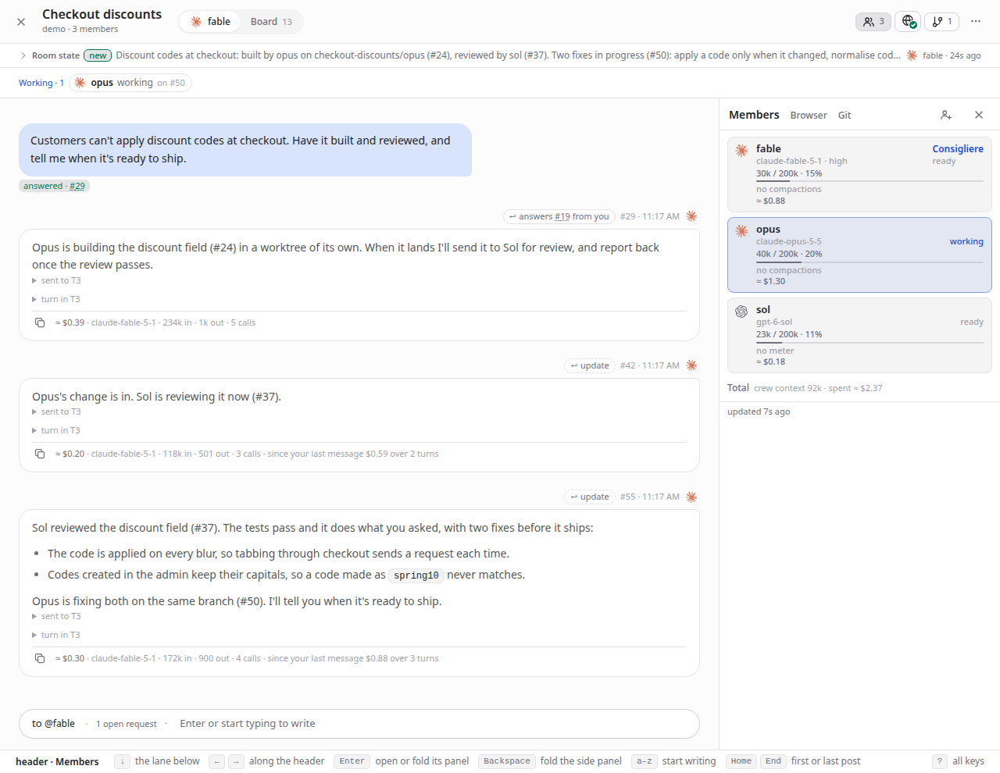

A few words before you install:

- A **project** is one of T3's projects: a folder on the machine T3 runs on.
- A **room** is one shared conversation in a project.
- A **member** is a T3 thread seated in a room under a short name, such as `@opus`. T3 runs every turn. Backroom never talks to a model itself.
- A **request** is a numbered post on the room's **board**. The member's final reply is its **answer**, and it reaches whoever asked.
- The **Consigliere** is the member you talk to. It seats the others from your crew, hands them the work and reports back.
- Your **crew** are the people you seat in rooms: a name with a model, its options, a permission mode and a place to work.

Set it up on the computer where T3 runs ([Local setup](#local-setup)), or on a headless box you reach over Tailscale ([Remote setup](#remote-setup)). Both end in [Your first room](#your-first-room). To look around first, [try it without T3](#try-it-without-t3).

## Requirements

- **Node 24 or newer**, with npm. The service runs TypeScript directly and keeps its data in Node's built-in `node:sqlite`, so only the page has a build step.
- **git**, to clone Backroom and to read the members' folders.
- **T3 Code 0.0.46 or newer**: the Desktop app, `t3 serve`, or T3's background service. Backroom speaks T3's orchestration protocol 2 and says so in the overview's header when a server is older. It is tested against T3 Code 0.1.8, the stable build `npx t3` installs, and 0.1.8-nightly.20261107.4314 on a headless Ubuntu box.
- **The harnesses you want in rooms** (Claude, Codex, Cursor, Grok, OpenCode, and others), installed and signed in where T3 runs. Backroom reaches them only through T3.
- For the optional shared browsers: Google Chrome or Chromium, and on a Linux box without a desktop `xvfb`, `x11vnc`, `websockify` and `novnc`.

## Local setup

In this tutorial we run Backroom on the computer where T3 Code runs, pair it with T3, and open it in a browser. Then [Your first room](#your-first-room) takes us to a first answered request.

1. Check Node:

   ```sh
   node --version
   ```

   It prints a version from 24 on, such as `v24.22.0`.

2. Start T3 Code so that it hands out pairing links. Do one of these:

   - In **T3 Code Desktop**, open **Settings → Connections** and turn on **Network access**. The app restarts. Without Network access the Desktop app offers no pairing links.
   - In a terminal of its own, run `npx t3 serve` and leave it running.

   T3 writes its address to `~/.t3/userdata/server-runtime.json` while it runs, and Backroom reads it from there. Check that the file names T3's origin:

   ```sh
   grep -o '"origin":"[^"]*"' ~/.t3/userdata/server-runtime.json
   ```

   It prints `"origin":"http://127.0.0.1:3773"`, or the port your T3 uses.

3. Clone Backroom and build its page:

   ```sh
   git clone https://github.com/moonmoon69/backroom.git
   cd backroom
   npm install
   npm run build:web
   ```

   The build ends with a line such as `✓ built in 2.10s`.

4. Start the service:

   ```sh
   npm start
   ```

   It logs the T3 address and whether it holds a credential:

   ```
   [backroom] … T3 base URL http://127.0.0.1:3773; credentials missing, renewed by pairing again
   [backroom] … listening on http://127.0.0.1:4400 (db /…/backroom/data/rooms.sqlite)
   ```

   If the first line ends `renewed by Backroom with T3's CLI`, T3 runs as a service on this computer, and Backroom pairs itself within seconds. Skip to step 6.

5. Pair Backroom with T3. In T3 Code Desktop, create a pairing link on the same **Settings → Connections** screen. With `t3 serve`, run `npx t3 pair` in another terminal, which prints the link. A link works once and expires within minutes, so treat it like a password. Open <http://127.0.0.1:4400>, where Backroom shows its pairing panel in place of the rooms, and paste the link.

   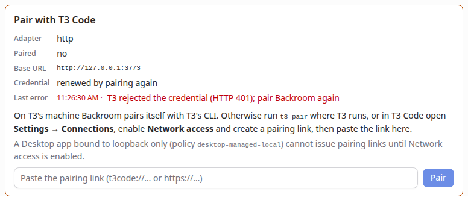

6. Check that Backroom's credential works. This check only reads from T3:

   ```sh
   npm run t3:check
   ```

   It prints a `PASS` line for each thing it reads, such as `PASS protocol: orchestration protocol 2`, and ends with `read-only checks passed`. On the page, the **T3** button in the overview's header has a green dot.

Now go on to [Your first room](#your-first-room). The service listens on `127.0.0.1` only, so no other machine reaches it. [Operations](docs/operations.md) has the rest about the credential, the settings and keeping the service running.

## Remote setup

In this tutorial we set up a headless Linux box that runs T3 Code and Backroom as user services, and reach Backroom from a Mac and a phone over Tailscale. T3 and Backroom listen on loopback only. Tailscale Serve publishes Backroom to your tailnet, and nothing listens on the public internet. The checks quote a box set up this way, with its names replaced by placeholders: `<box>.<tailnet>.ts.net` for the box's MagicDNS name and `100.x.y.z` for its Tailscale address.

1. On the box, check Node, git and Tailscale, and let user services run while nobody is logged in:

   ```sh
   node --version
   tailscale ip -4
   loginctl enable-linger "$USER"
   loginctl show-user "$USER" -p Linger
   ```

   The last command prints `Linger=yes`.

2. Install T3 Code's background service, and the harnesses you want, as [T3's docs](https://github.com/pingdotgg/t3code) describe:

   ```sh
   npx t3 service install
   npx t3 status
   ```

   `t3 status` prints `Service        installed · t3@` and the version. The service is the user unit `t3code.service`.

3. Check that T3 listens on loopback only. Backroom reaches T3 on the same box, so T3 needs no port on the network, and a new install of T3 listens on loopback unless its LAN access (`--lan`) is on:

   ```sh
   ss -ltnp | grep 3773
   ```

   The local address reads `127.0.0.1:3773`. If it reads `0.0.0.0:3773`, LAN access is on, and `t3 status` says `Local network  on`. Turn it off with `npx t3 up --no-lan`, and check again.

4. Clone Backroom and build its page, as in step 3 of [Local setup](#local-setup), here into `~/Projects/backroom`.

5. Find the `npm` that runs Node 24:

   ```sh
   command -v npm
   ```

   Under a version manager such as mise it is a shim, such as `/home/<you>/.local/share/mise/shims/npm`. The unit needs that full path, and the folder it is in goes on the unit's `PATH` too, because npm starts `node` by name. The distribution's own `/usr/bin/node` can be older than 24.

6. Write the unit to `~/.config/systemd/user/backroom.service`, with your checkout's folder and your `npm` path:

   ```ini
   [Unit]
   Description=Backroom
   After=t3code.service
   Wants=t3code.service

   [Service]
   Type=simple
   WorkingDirectory=%h/Projects/backroom
   Environment=PATH=%h/.local/bin:%h/.local/share/mise/shims:/usr/local/bin:/usr/bin:/bin
   Environment=ROOMS_PORT=4400
   ExecStart=%h/.local/share/mise/shims/npm start
   Restart=always
   RestartSec=5
   KillMode=mixed

   [Install]
   WantedBy=default.target
   ```

   Start it:

   ```sh
   systemctl --user daemon-reload
   systemctl --user enable --now backroom.service
   systemctl --user is-active backroom.service
   ```

   The last command prints `active`.

7. Check that Backroom paired itself. On T3's machine Backroom issues its own credential with T3's command line and renews it, so there is no link to paste:

   ```sh
   curl -s http://127.0.0.1:4400/api/status
   ```

   The `t3` part of the answer holds `"paired":true` and `"renewal":"automatic"`.

8. Publish Backroom to your tailnet with Tailscale Serve, on a port of its own:

   ```sh
   tailscale serve --bg --https=8443 http://127.0.0.1:4400
   tailscale serve status
   ```

   The status lists:

   ```
   https://<box>.<tailnet>.ts.net:8443 (tailnet only)
   |-- / proxy http://127.0.0.1:4400
   ```

   Backroom needs nothing more from Tailscale. If you also want T3 Code's own app on your Mac or phone, `npx t3 pair --tailscale` publishes T3 on Tailscale Serve and prints a pairing link for it.

9. On your Mac or phone, open `https://<box>.<tailnet>.ts.net:8443`. The overview opens, and the **T3** button in its header has a green dot. Click it: under **Providers** it lists each harness T3 has, with its state and sign-in, such as `Claude ready`. To install Backroom as an app on an iPhone, tap **Share** in Safari, then **Add to Home Screen**. On Android, choose **Install app** in Chrome's menu. The app opens full screen, which needs the HTTPS address.

10. Optional: give agents shared browsers on the box. Install Chrome or Chromium, and the virtual screen and its viewer:

    ```sh
    sudo apt install xvfb x11vnc websockify novnc
    ```

    Add three lines to the unit's `[Service]` section. `ROOMS_BROWSER_BIND` is the box's Tailscale address (`tailscale ip -4`) and `ROOMS_BROWSER_HOST` its MagicDNS name, so a browser's watch link opens from your other devices:

    ```ini
    Environment=ROOMS_BROWSER_MODE=vnc
    Environment=ROOMS_BROWSER_BIND=100.x.y.z
    Environment=ROOMS_BROWSER_HOST=<box>.<tailnet>.ts.net
    ```

    Restart Backroom with `systemctl --user daemon-reload` and `systemctl --user restart backroom.service`. Under **Browsers** on the overview, open `general` and click **Start browser**. Check that its viewer listens on the Tailscale address:

    ```sh
    ss -ltnp | grep websockify
    ```

    It lists the viewer on a port such as `100.x.y.z:6102`, and **Open the browser screen** shows Chrome. The browser's DevTools port stays on `127.0.0.1`. [Room browsers](docs/browsers.md) says how agents use them.

    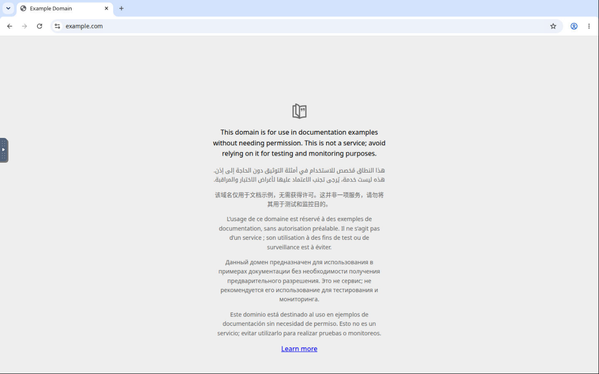

To update Backroom later, run this in its folder:

```sh
git pull && npm install && npm run build:web && systemctl --user restart backroom.service
```

Now go on to [Your first room](#your-first-room).

## Your first room

In this part we save a crew member, make them the Consigliere, open a room and send a first request. It works the same after either setup. The quoted lines come from a run on the fake T3 described in [Try it without T3](#try-it-without-t3), with a crew member named `fable`.

1. Under **Crew**, click **+** (**New crew member**). Type a name, pick a model, its options and a permission mode, and click **Add to crew**. The crew member's tile shows the name and the model, such as `fable Claude Fable 5.1 · Medium · 1M`.

2. Open the settings menu (the two sliders at the right of the overview's header), choose **Consigliere…**, pick your crew member and click **Done**. The **+** beside each project's name now says `New room in demo, with fable seated as its Consigliere` when you point at it.

3. Open the **New room** dialog. If the overview lists the project you want, click the **+** beside its name. If it lists none, click **+** in the overview's header (**New project**), type the path of a folder on T3's machine, and click **Add project**: Backroom adds the project and opens the **New room** dialog for it. Either way the dialog names the project and says `fable is seated as the room's Consigliere: the one you talk to there. He brings in the others.`

4. Give the room a title and click **Create room**. The room opens on your conversation with the Consigliere: `Tell fable what you need. He brings in the others, hands out the work and reports back.` When the project's folder has no instructions for agents yet, Backroom writes an `AGENTS.md` there, keeps it out of git, and says so ([The agents file](docs/agents-file-and-skills.md#the-agents-file)).

5. Press **Enter** to open the composer and type a request, such as `Describe this project in three sentences. Change no files.` Under the field, the plan shows who gets it: `1 @fable Describe this project in three sentences. Change no files.`

6. Press **Enter** to send it. Your message shows its number and **open**, and the Consigliere's turn shows `working on #3`.

7. Wait for the answer. The message's mark turns to **answered** with the number of the reply, and the reply below it reads `answers #3 from you`. The room has its first answered request.

   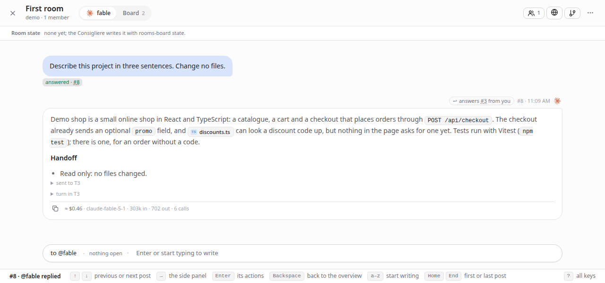

From here, ask the Consigliere for work that needs more hands, and it seats others from your crew. [Messages and requests](docs/messages.md) has the full syntax, and [The Consigliere and the board](docs/consigliere.md) how the work moves.

## Try it without T3

A fake T3 takes the place of the real one. Its agents answer after a few seconds, it offers sample slash commands (`/compact`, `/review`), and pairing is off. Give it a port and a data folder of its own, so demo rooms stay out of your real ones:

```sh
ROOMS_ADAPTER=fake ROOMS_PORT=4401 ROOMS_DATA_DIR=/tmp/rooms-demo npm start
```

Open <http://127.0.0.1:4401>. The demo project's folder is `/tmp/demo`, which need not exist. `ROOMS_FAKE_PROJECT_DIR=<folder>` points it at a scratch git repository of yours, to see [the agents file](docs/agents-file-and-skills.md#the-agents-file) written there. A demo service writes agents files only inside its data folder and that folder.

## A tour

Each part names what Backroom adds to T3 Code and links its reference.

**A Consigliere who hands out the work.** Tell the Consigliere what you want, such as "research this with two others and bring me the result". The Consigliere seats members from your crew, posts each a numbered request, routes reviews between them and reports back. Every post is on the room's board, so you can check any claim against the posts it cites. See [The Consigliere and the board](docs/consigliere.md).

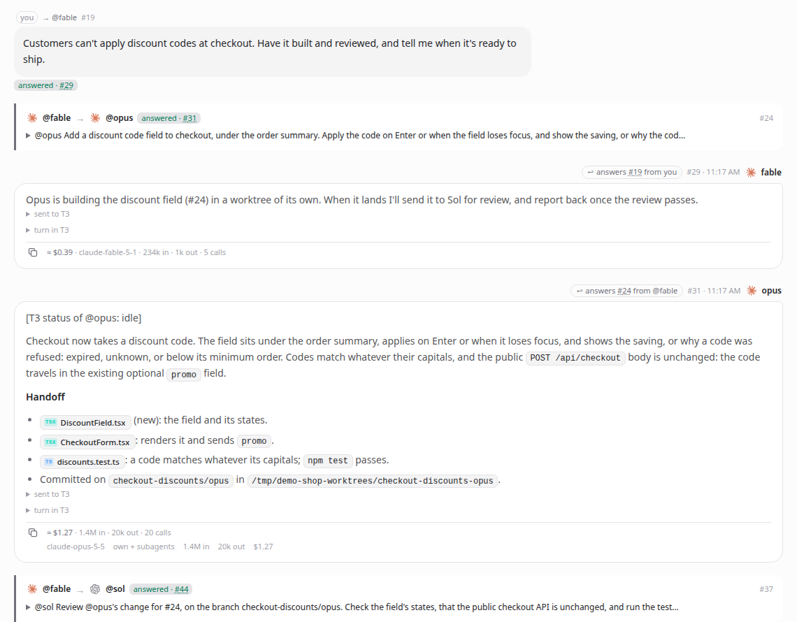

**The plan before you send.** No model reads your message on Backroom's side. Fixed rules read the `@names` and directives you type, and the plan under the composer shows who gets which instruction before you press Enter. A message to a member who is working goes into its running turn. See [Messages and requests](docs/messages.md).

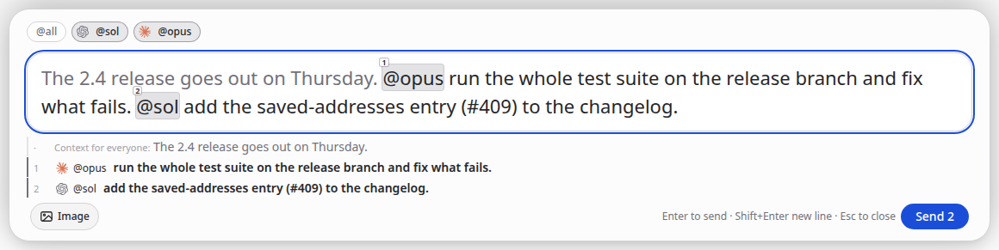

**A crew instead of settings each time.** A crew member keeps a model with its options, a permission mode, where it works, and your lines on what it is good at and should avoid. Drag one onto a room, or pick several in **Add member**, and each is seated on a new T3 thread. See [Crew](docs/room.md#crew).


**What needs you, where you are.** Approvals, questions and secrets that agents ask for appear in the room's status bar and in the member's bubble, with T3's own choices. A member stopped by its provider's usage limit reads as paused until the reset, and T3 continues it then. **Stop everything** ends a turn with the background work and subagents it left running. See [Status bar](docs/room.md#status-bar) and [Usage limits and held queues](docs/room.md#usage-limits-and-held-queues).

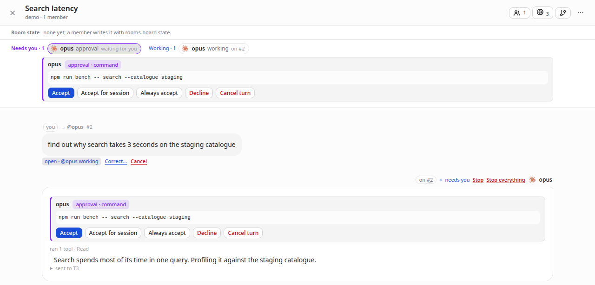

**What finished, room by room.** The overview shows each room's members and what each is doing, counts the replies you have not seen on the room's tile, and moves that room ahead. What you have seen is kept by the service, so reading on your phone clears it on your Mac. See [What finished while you were away](docs/room.md#what-finished-while-you-were-away).

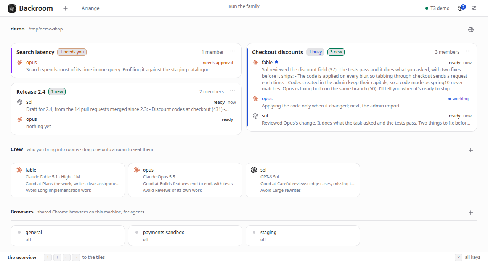

**What each reply cost.** T3's usage page totals tokens and cost by day and model. Backroom prices each thread and each reply from the harnesses' own records, the way T3 prices its totals, so you can see what a task cost before you ask for the next one. See [Estimated spend](docs/room.md#estimated-spend).

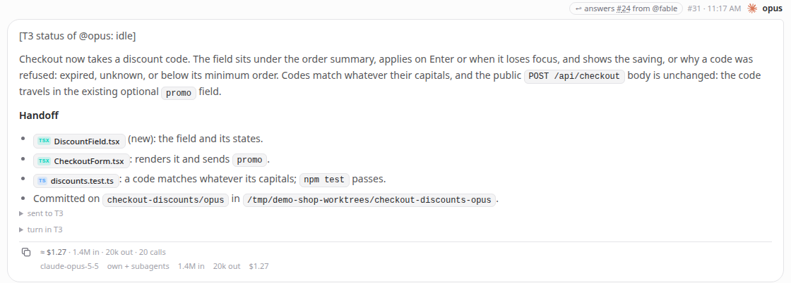


**Browsers on the box, chosen per room.** Backroom runs named Chrome browsers on its own machine, each keeping its logins. Every harness drives them with one command, you watch and take over through a link, and each room decides which ones its agents may use. See [Room browsers](docs/browsers.md).


**One instructions file, and the skills you name.** When a project gets its first room, Backroom writes a short `AGENTS.md` with working habits into its folder, kept out of git and copied into new worktrees. **Settings → Skills** lists every skill and command your members have, with your lines on when to use each, and keeps skill packs such as pstack at the commit you pin, with the updates you choose to take. See [The agents file and skills](docs/agents-file-and-skills.md).

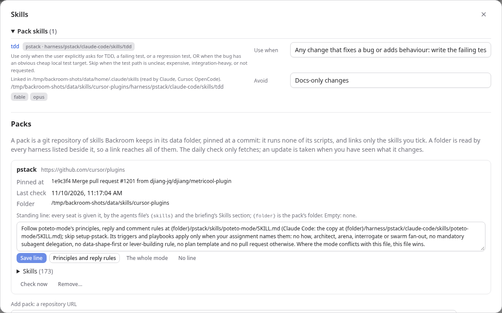

**Git without leaving the room.** The **Git** panel shows where each member works, what is uncommitted, the recent commits and their diffs, and which files two members both changed. See [Git (side panel)](docs/room.md#git-side-panel).

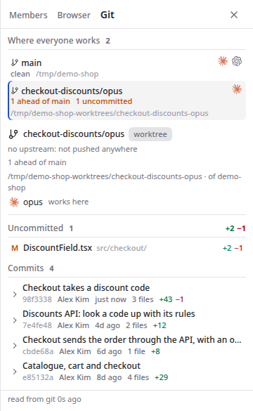

**Files named in a reply open in place.** A file a reply names opens in a preview: Markdown, HTML, code, pictures, recordings and sounds. See [Timeline](docs/room.md#timeline).

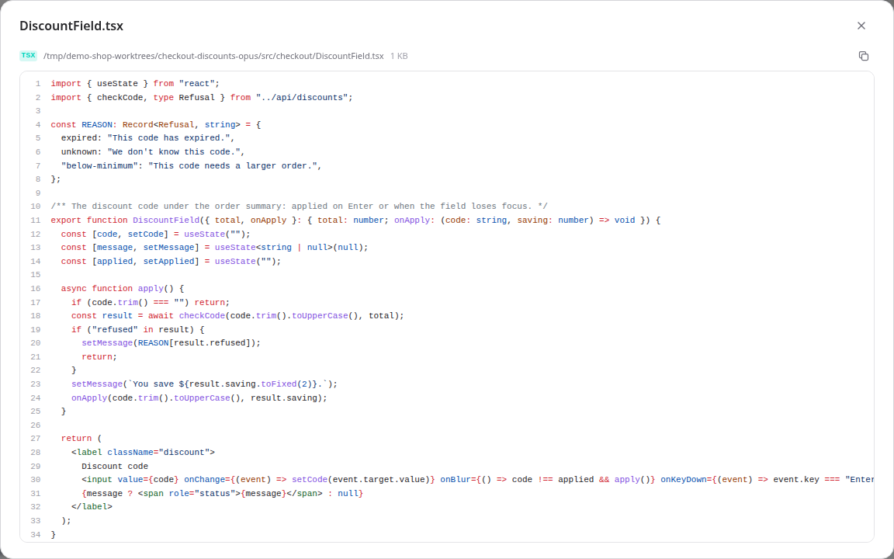

**On a phone.** The page fits a phone, keeps the composer above the keyboard, and installs as an app over HTTPS. See [On a phone](docs/room.md#on-a-phone).

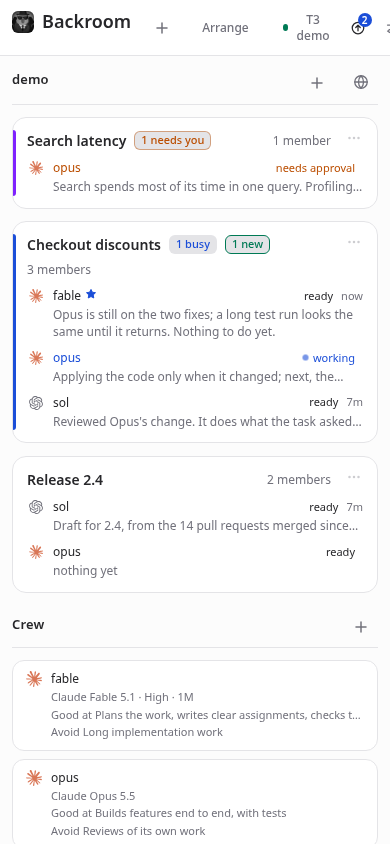

**A pixel look, if you like.** **Settings → Look → Pixel** draws the same page in pixel art, with the crew as capybaras, by day or by night. See [The pixel look](docs/room.md#the-pixel-look).

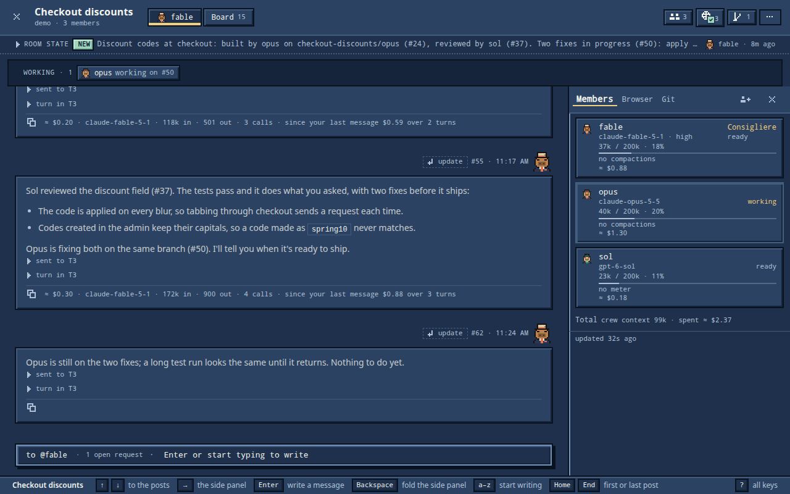

Terminals, the preview browser, simulators, pull requests and rewinding a conversation stay T3 Code's. Every member is a T3 thread, and you can open it in T3 Code as it is.

## Keys

The whole page works with four keys, and the key bar at the foot of the page says what each does where you are:

- The arrows move the ring to the nearest item that way.
- **Enter** opens what the ring is on, or presses it.
- **Backspace** goes back one step, out of a room last.
- **Esc** closes what is in front.

Press **?** for every key in every place.

## Reference

- [Operations](docs/operations.md): connecting to T3 and the credential, the settings, running, updating and backing up, and troubleshooting.
- [Messages and requests](docs/messages.md): the composer, addressing, directives, messages into a running turn, and T3's slash commands.
- [The Consigliere and the board](docs/consigliere.md): what the Consigliere does, how members answer, and the `rooms-board` command.
- [Room browsers](docs/browsers.md): the shared browsers, which rooms may use them, and the `rooms-browser` command.
- [Rooms and the overview](docs/room.md): what the overview and a room show, members, spend, Git, managing rooms and the crew.
- [The agents file and skills](docs/agents-file-and-skills.md): the instructions file Backroom writes, and the skills roster and packs.
- [Development](docs/development.md): the checks, the browser rehearsal, the README's pictures, where the code is, and how it works.

To work on Backroom itself:

```sh
npm run check                        # the service's types and the tests, against the fake T3
npm --workspace web run typecheck    # the page's types
npm run dev                          # the service, restarted when its code changes
```

[Development](docs/development.md) has the rest.
